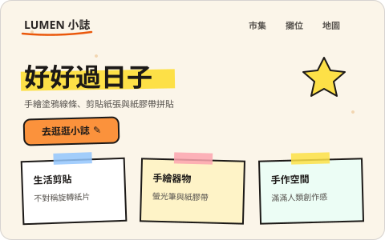

# ⑮ 手繪拼貼雜誌風（Hand-drawn / Zine Collage）

> **一句話：紙膠帶、螢光筆劃重點、手繪塗鴉線條與微傾斜剪貼紙片，最有「人類親手做」的溫度、最不像 AI 公版。**



| 項目 | 規格特徵 |
| :--- | :--- |
| **象限位置** | 感性 × 熱鬧（手作創作者感、俏皮有故事、獨一無二） |
| **最適合** | 獨立創作者／插畫家作品集、週末市集、獨立出版 Zine 展、親子繪本活動 |
| **不適合** | 企業軟體後台、金融數據儀表板、法律或醫療正式機構 |
| **核心配色** | 暖米牛皮紙底 `#FBF5E9` ＋ 炭黑墨線 `#1C1917` ＋ 螢光筆黃 `#FDE047` ＋ 暖橘 `#FB923C` ＋ 紙膠帶粉藍／粉紅 |
| **字型搭配** | 活潑手寫或圓潤標題字（`Shantell Sans` / `Klee One` / `Zen Maru Gothic`）＋ 易讀內文（`Noto Sans TC`） |
| **形狀與細節** | 卡片上方加半透明「紙膠帶」矩形貼條；微幅左右旋轉（`-2deg` 到 `2deg`）；標題底下的螢光筆塗色塊；手繪感 SVG 波浪底線 |

---

## 📄 專屬 `PRD.md` 範例（草地小誌祭 Zine & Picnic）

<details>
<summary>點此展開複製 PRD.md：草地小誌祭 Zine & Picnic（獨立插畫與手作小誌市集）</summary>

```markdown
# PRD：草地小誌祭 Zine & Picnic — 獨立插畫與手作小誌野餐市集

## 1. 網站簡介
- **活動名稱**：草地小誌祭 Zine & Picnic
- **專案定位**：號召獨立插畫家、攝影師與手工書創作者擺攤交流的免費入場草地市集活動頁
- **目標對象**：喜歡獨立出版、插畫貼紙、手繪創作與假日野餐的大學生與文創愛好者
- **核心轉換目標**：點擊「報名創作者攤位」或「免費登記逛展提醒」

## 2. 頁面區塊與文案內容

### ① 塗鴉感導覽列（Header）
- 左側名稱：草地小誌祭 ✎
- 右側連結：出攤名單、手繪小教室、野餐地圖
- 右側按鈕：免費登記逛展

### ② 主視覺區（Hero）
- 主標語：帶一塊野餐墊，把喜歡的小誌帶回家
- 副標語：80 位獨立創作者、手作網版印刷體驗、草地吉他彈唱，這個週末在華山大草原見！
- 主要按鈕：免費登記逛展
- 次要按鈕：創作者攤位報名

### ③ 三大市集角落（3 張貼上紙膠帶的微傾斜剪貼卡片）
1. **獨立小誌交換角**｜帶一本你做的小書或塗鴉本，現場就能和陌生創作者交換靈感
2. **隨手網版印刷攤**｜現場挑選插畫圖案，3 分鐘把圖案印在自己的帆布袋上
3. **草地塗鴉接力牆**｜提供超大卷牛皮紙與彩色麥克筆，歡迎大家一起畫滿整面牆

### ④ 活動資訊與頁尾（Footer）
- 時間地點：2026.11.14–15 11:00–17:30｜台北華山中央藝文公園
- 聯絡信箱：hi@zine-picnic.example
- 版權宣告：草地小誌祭籌備小組 手工整理 © 2026
```

</details>

---

## 🤖 產生 `DESIGN.md` 的參考 Prompt

```text
請讀取附件 PRD.md，為「草地小誌祭 Zine & Picnic」產出一份手繪拼貼雜誌風（Zine Collage）的 DESIGN.md
（上方 YAML Token ＋ 下方 10 個標準 Markdown 章節）。

設計關鍵字與規則：
- 核心關鍵字：手繪拼貼小誌風（Zine & Scrapbook 美學）、暖米牛皮紙底色（#FBF5E9）、手繪炭黑墨線（2px solid #1C1917）、標題後方加上半歪斜的螢光筆黃色底塊（#FDE047）、卡片頂部中央貼上半透明彩色紙膠帶（Washi Tape）裝飾條、三張卡片各自做輕微不對稱旋轉（-2deg, 1.5deg, -1deg）、點綴少量手繪感 SVG 波浪底線或星星塗鴉
- 繁體中文字型：標題使用 Klee One（或 Zen Maru Gothic 700），內文使用 Noto Sans TC（附 Google Fonts CDN）
- 避坑規則：千萬不要看起來像工整無聊的科技公司網頁、不要冰冷的純白或漸層背景、卡片旋轉角度不可過大（維持 ±2 度內確保文字好讀）
```

### 🔑 這個 Prompt 的關鍵字教學：為什麼這樣寫？

| 關鍵字 | AI 讀到它會做什麼 | 不寫會出現什麼問題 |
| :--- | :--- | :--- |
| **卡片頂部貼上半透明紙膠帶** | 用 CSS 偽元素在每張卡片頂端畫一條半透明藍色／粉色斜貼膠帶 | 這是低成本做出「手作剪貼簿」視覺效果的最強絕招 |
| **標題後方加螢光筆黃色底塊** | 用 `linear-gradient` 或色塊做在標題文字下半部 | 模擬真人拿螢光筆劃重點的筆觸，生動又自然 |
| **輕微不對稱旋轉（±2 度內）** | 打破網頁千篇一律的水平垂直排列 | 超過 5 度會讓文字難閱讀，限制 ±2 度剛剛好有手作韻味 |
| **Klee One / 手寫楷感字型** | 採用帶有硬筆手寫筆觸的免費 Google Font | 比一般黑體多了濃濃的插畫創作氣息 |
| **牛皮紙暖底＋炭黑墨線** | 像真實翻開一本彩色紙剪貼筆記本 | 瞬間消除 AI 生成網頁常有的冰冷數位感 |

---

[⬅️ 返回 03. 常用設計風格圖鑑](../03_常用設計風格圖鑑.md)
