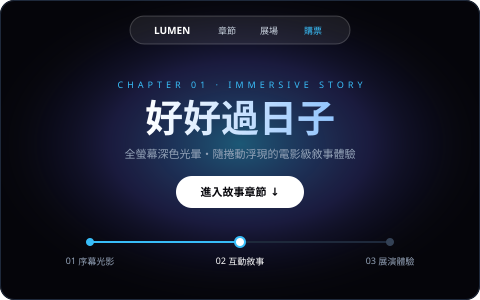

# ⑯ 沉浸式光影敘事風（Immersive / Scrollytelling）

> **一句話：全螢幕深邃夜色搭配極光流體光暈、置中電影級巨型宣言，像在瀏覽一場數位展覽。**



| 項目 | 規格特徵 |
| :--- | :--- |
| **象限位置** | 感性 × 熱鬧（戲劇張力、電影敘事感、強沉浸體驗） |
| **最適合** | 年度旗艦硬體發表（如高階耳機／電動車）、沉浸式數位光影展、紀錄片／影展宣傳網站 |
| **不適合** | 強調快速搜尋查資料的百科網站、日常工具表單 |
| **核心配色** | 宇宙深黑 `#05050A` ＋ 純白高光字 `#FFFFFF` ＋ 淺霧藍灰 `#94A3B8` ＋ 極光流體漸層 `#38BDF8` / `#6366F1` |
| **字型搭配** | 具視覺份量的無襯線標題（`Outfit` ＋ `Noto Sans TC` 字重 700–800），標題可做微幅白到冰藍文字漸層 |
| **形狀與動態** | 懸浮膠囊導覽列；隨捲動（Scroll）逐章節淡入浮現的文字段落；高飽和極光光暈背景；章節進度指示線 |

---

## 📄 專屬 `PRD.md` 範例（深海微光 Abyssal Glow）

<details>
<summary>點此展開複製 PRD.md：深海微光 Abyssal Glow（海洋科技沉浸式光影展）</summary>

```markdown
# PRD：深海微光 Abyssal Glow — 海洋生物發光數位沉浸展

## 1. 網站簡介
- **展覽名稱**：深海微光 Abyssal Glow
- **專案定位**：以捲動敘事帶領訪客模擬潛入海面下 4,000 公尺、探索發光生物與聲景的數位展覽購票頁
- **目標對象**：喜歡沉浸式光影展（如 teamLab）、自然科學與假日親子／情侶約會看展族群
- **核心轉換目標**：點擊「預訂沉潛體驗票」前往購票

## 2. 頁面區塊與文案內容

### ① 懸浮膠囊導覽列（Floating Pill Header）
- 品牌標記：ABYSSAL GLOW
- 導覽連結：01 序幕光影、02 深潛章節、03 展場資訊
- 按鈕：預訂門票

### ② 全螢幕電影主視覺（Hero）
- 英文章節眉標：`DEPTH 0M · CHAPTER 01`
- 主標語：潛入海面下四千公尺的無聲極光
- 副標語：一場結合即時水母投影、深海鯨歌聲場與互動光波感應的 360 度感官特展。
- 主要按鈕：開始下潛探索 ↓

### ③ 捲動敘事三章節（隨螢幕捲動切換焦點）
1. **章節 01｜200 公尺・微光層**｜陽光最後一絲藍色折射，浮游生物在暗流裡閃爍
2. **章節 02｜1,500 公尺・生物冷光**｜深海燈籠魚與發光水母，用藍綠螢光寫下無聲對話
3. **章節 03｜4,000 公尺・實體展廳**｜走進高雄駁二特區 800 坪全黑空間，伸手觸碰互動光流

### ④ 購票行動與頁尾（Footer）
- 展期資訊：2026.06.01 – 10.31｜高雄駁二藝術特區 B4 倉庫
- 票價：早鳥單人票 NT$ 380｜雙人星光票 NT$ 700
- 版權宣告：© 2026 ABYSSAL GLOW EXHIBITION
```

</details>

---

## 🤖 產生 `DESIGN.md` 的參考 Prompt

```text
請讀取附件 PRD.md，為「深海微光 Abyssal Glow」產出一份沉浸式光影敘事風（Immersive / Scrollytelling）的 DESIGN.md
（上方 YAML Token ＋ 下方 10 個標準 Markdown 章節）。

設計關鍵字與規則：
- 核心關鍵字：沉浸式光影敘事風（Apple 旗艦產品頁／teamLab 數位展質感）、全螢幕宇宙深黑底（#05050A）、居中超大電影級標題搭配細微冰藍文字漸層（linear-gradient #FFFFFF to #93C5FD）、背景加入柔和的深海極光流體光暈（Mesh Gradient #38BDF8 & #6366F1）、上方懸浮半透明膠囊導覽列、隨捲動逐段淡入浮現的章節結構（Scroll-triggered fade-in）與章節深度進度條
- 繁體中文字型：標題使用 Outfit ＋ Noto Sans TC（700-800），深度數值標籤使用 JetBrains Mono（附 Google Fonts CDN）
- 避坑規則：文字段落保持極度簡短（每次螢幕只講一個重點，不要長篇大論）、確保深黑底上所有文字皆為高對比白色或淺霧藍（不要暗灰字）
```

### 🔑 這個 Prompt 的關鍵字教學：為什麼這樣寫？

| 關鍵字 | AI 讀到它會做什麼 | 不寫會出現什麼問題 |
| :--- | :--- | :--- |
| **全螢幕電影級置中章節** | 把每個區塊都做成 `min-height: 100vh` 的滿版體驗 | 如果沒寫，AI 會把三個章節擠成三張並排小卡片，瞬間沒了「沉浸感」 |
| **流體光暈（Mesh Gradient）** | 在深黑背景緩慢鋪開深海藍與靛紫極光 | 比單調死黑更具空間深度，能呼應展覽或科技主題 |
| **標題細微白到冰藍文字漸層** | 使用 `background-clip: text` 做出金屬光影感標題 | 讓核心宣言字句像被聚光燈打亮一樣有主角氣場 |
| **Scroll-triggered fade-in＋進度條** | 加入 IntersectionObserver 捲動淡入與章節進度指示 | 讓使用者往下滑時有「一幕一幕往下潛」的敘事節奏 |
| **每次螢幕只講一個重點** | 強迫控制單屏字數，留出巨大黑暗負空間 | 文字太多會破壞展覽級的電影沉浸體驗 |

---

[⬅️ 返回 03. 常用設計風格圖鑑](../03_常用設計風格圖鑑.md)
