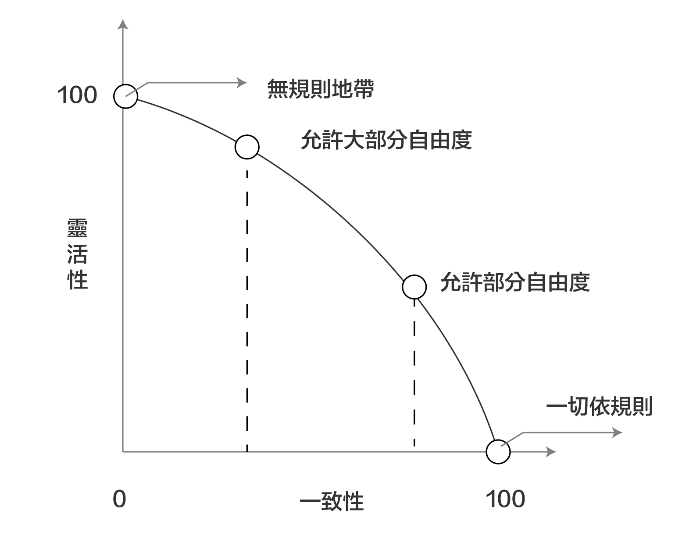
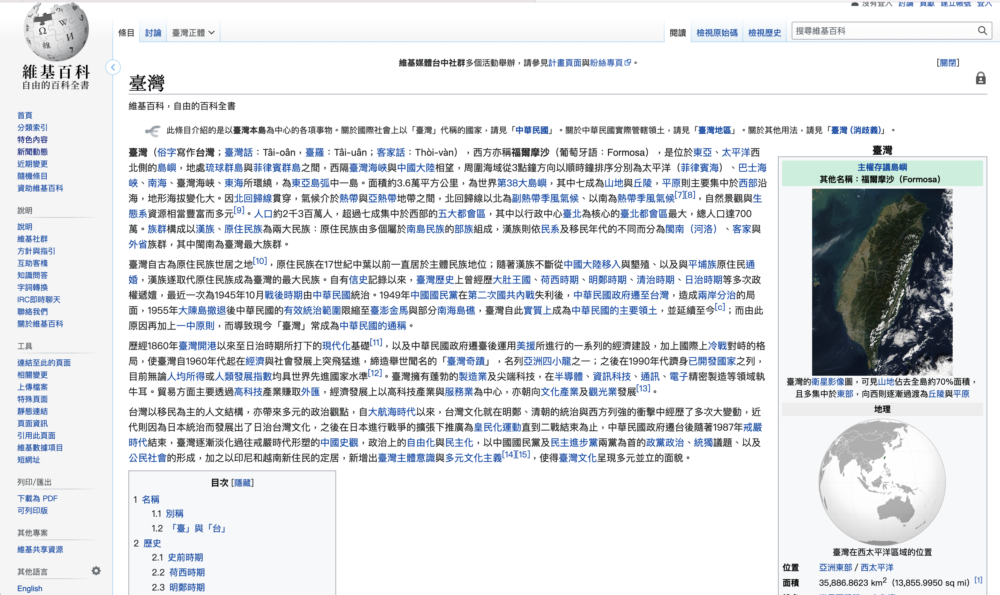

# 一致性

## 01 一致性與靈活性

### 規則性與自由度

一致性與靈活性是互相拉扯的關係：一方變強，另一方就會變弱。「一致性」可以理解為 **規則性**，「靈活性」則等同於 **自由度**。

擁有 100% 一致性的網站或應用程式，會有許多嚴格的規則，例如元素與元件都是固定的，新的元素很難在既有結構中找到位置。相對地，這種設計有助於嚴格控管整個網站，Wikipedia 就是典型的例子。

反過來說，擁有 100% 靈活性的網站就像一片「無規則地帶」：可以隨意決定網站結構，也能在頁面上放任何元素。沒有規則代表擁有最高的自由度，但也代表頁面之間毫無整體感。早期草創時代的個人網站，就是這類的例子。

> 靈活度高的 Apple 網站

如今大多數網站與應用程式都介於兩者之間，同時擁有一定程度的一致性與靈活性。只要不追求 100% 的一致性，就能保留更多靈活性；反過來，犧牲一部分靈活性，就能換得更多一致性（例如讓 Logo、頁首、頁尾的設計統一），讓網站更有整體感，原本各自獨立的頁面也能組成一個完整的網站。

> 一致性高的網站

### 先決定比例，再建立規則

要追求多高的一致性與靈活性，是設計網站時的重點之一，而且必須先釐清網站與應用程式的功能與目的，才能決定方向。如果可以，建議在設計初期就先決定兩者的比例。**越重要的規則越要先建立**，因為先有規則再設計，會比從雜亂的設計中事後歸納出規則容易得多。

建立一致性規則時，重點應放在 **「不容易產生例外的規則」**，而不是「完全不允許例外的規則」。也就是說，網站的外觀應該有足以承受突發狀況的整體感。有時候確實需要、甚至必須跳脫規則，才能提升整體效果；但即使要做不符合規則的設計，也應該只限於細節，盡量不要動到必須遵守規則的區塊。

總之，關鍵是在 **不產生違和感** 的前提下維持一致性，藉此提升網站的效果、意義與實用性。

---

## 02 一致性的效果

### 易懂性與實用性

要讓使用者感覺自己仍在「同一個網站或應用程式」裡，操作方式與視覺設計就必須一致。例如：用相同的規則設計頁首、頁尾、顏色、按鈕、圖示，以及導覽列的操作方式。

具有一致性的介面，能同時兼顧 **易懂性與實用性**。舉例來說，許多使用者覺得 iPhone 的應用程式比 Android 的應用程式容易操作，原因可能是整個系統的操作方式較簡單，或視覺元素較統一；但另一個重要原因，是 **iOS 的應用程式都有自己的「返回」按鈕**，而這個按鈕連帶地為所有頁面創造了一致性。

iPhone 在硬體與作業系統層級都沒有提供通用的「返回」按鈕，所以必須由各個應用程式自行提供。因為幾乎每個應用程式都需要這個功能，通常就會在頁首標題的左側放一個顯示「上一頁名稱」的返回按鈕。

另一方面，Android 的「返回」功能由硬體按鍵或系統手勢提供，因此應用程式不必像 iOS 一樣在畫面中放置返回按鈕，也不一定要把它放在頁首。

iOS 的返回按鈕雖然會佔用頁首空間，卻能清楚標示「目前所在位置」與「上一頁的名稱」。由於大多數頁面都需要返回按鈕，結果反而讓所有頁面都能顯示所在位置與上一頁名稱，等於為每個頁面帶來了一致性，也讓 iOS 的操作更加簡單好用。

相較之下，Android 的設計較不受拘束，能否做出一致的介面，就要看開發人員與設計師的功力；而功力的高低，也決定了應用程式的自由度與操作上的實用性。

---

## 03 「迷路」的原因何在？

### 兩大原因

- **不知道自己身在何處**
- **不知道該如何操作**

在網站或應用程式裡「迷路」，到底是什麼狀態？大致可以歸納出兩大原因：一是「不知道自己身在何處」，二是「不知道該如何操作」，或者兩者同時發生。更精確地說，就是 **「無法掌握這個頁面在整個網站中的相對位置」**，以及 **「不了解操作的規則與一致性」**。

以開車前往目的地為例：不知道該往哪個方向開，就是「不知道身在何處」；不知道車子該怎麼開，就是「不知道如何操作」。只要兩者都了解，就能順利抵達目的地。

### 標示相對位置，維持操作一致

為了讓使用者知道自己身在何處，必須提示 **目前位置與整體之間的相對關係**。例如在全域導覽列、區域導覽列、麵包屑導覽中標示目前所在位置，或利用畫面的變化量、換頁時的互動效果來表現前後關係（參考 [垂直、水平、前後的立體構造](../垂直_水平_前後的立體構造/README.md)）。

為了讓使用者知道如何操作，則必須設計出 **有規則、有一致性的操作方式**。版型、頁面元素與元件都應該有一致的用法與效果；這種一致性能讓使用者預測接下來的操作會產生什麼結果。

由此可知，**相對位置的標示** 與 **操作方式的一致性**，都是讓網站或應用程式變得「簡單易懂」的重要因素。

---

[⬅️ 返回網站架構觀念](../README.md)
