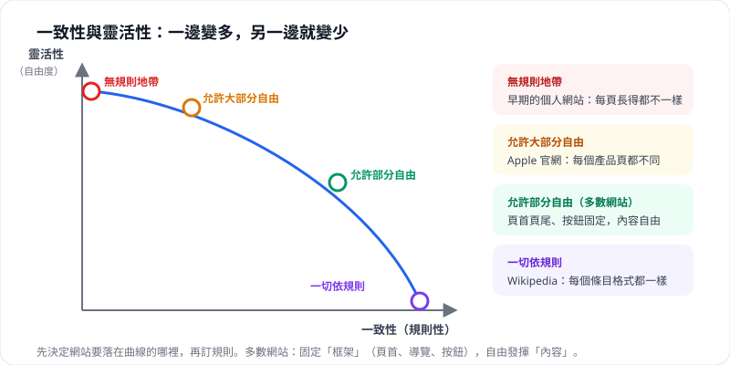
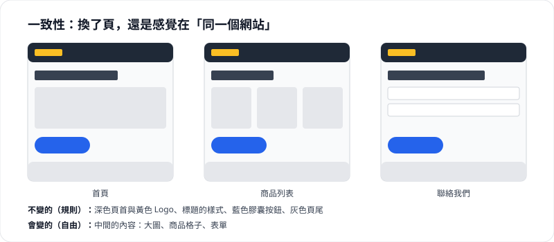
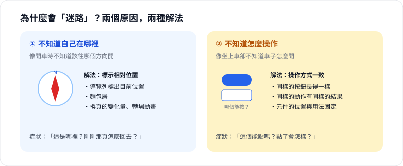

# 一致性

> 每個觀念後面都有「🤖 用 AI 實作這個觀念」。用 AI 做網站最常見的問題，就是「一頁一頁分開做，結果每頁都長得不一樣」。這一章的觀念，正好是用 AI 做網站時最需要的眼光。

---

## 01 一致性與靈活性

### 規則性與自由度

一致性與靈活性是互相拉扯的關係：一方變強，另一方就會變弱。「一致性」可以理解為 **規則性**，「靈活性」則等同於 **自由度**。



擁有 100% 一致性的網站或應用程式，會有許多嚴格的規則，例如元素與元件都是固定的，新的元素很難在既有結構中找到位置。相對地，這種設計有助於嚴格控管整個網站，Wikipedia 就是典型的例子。

反過來說，擁有 100% 靈活性的網站就像一片「無規則地帶」：可以隨意決定網站結構，也能在頁面上放任何元素。沒有規則代表擁有最高的自由度，但也代表頁面之間毫無整體感。早期草創時代的個人網站，就是這類的例子。

**靈活度高的例子：Apple 官網**，每個產品頁的版面、顏色、動畫都不一樣，但頁首與導覽列仍然一致：

[](https://youtu.be/gr-R-9-9tzM)

如今大多數網站與應用程式都介於兩者之間，同時擁有一定程度的一致性與靈活性。只要不追求 100% 的一致性，就能保留更多靈活性；反過來，犧牲一部分靈活性，就能換得更多一致性（例如讓 Logo、頁首、頁尾的設計統一），讓網站更有整體感，原本各自獨立的頁面也能組成一個完整的網站。

**一致性高的例子：Wikipedia**，每個條目都使用相同的版面、目錄、資訊框：


### 先決定比例，再建立規則

要追求多高的一致性與靈活性，是設計網站時的重點之一，而且必須先釐清網站與應用程式的功能與目的，才能決定方向。如果可以，建議在設計初期就先決定兩者的比例。**越重要的規則越要先建立**，因為先有規則再設計，會比從雜亂的設計中事後歸納出規則容易得多。

建立一致性規則時，重點應放在 **「不容易產生例外的規則」**，而不是「完全不允許例外的規則」。也就是說，網站的外觀應該有足以承受突發狀況的整體感。有時候確實需要、甚至必須跳脫規則，才能提升整體效果；但即使要做不符合規則的設計，也應該只限於細節，盡量不要動到必須遵守規則的區塊。

總之，關鍵是在 **不產生違和感** 的前提下維持一致性，藉此提升網站的效果、意義與實用性。

### 🤖 用 AI 實作這個觀念

「先有規則再設計」用在 AI 上，就是先寫好設計規範，再請 AI 做頁面。

<details>
<summary>📋 Prompt：先訂規則，再請 AI 做頁面</summary>

```text
我要做一個【社區咖啡館】的網站，有首頁、菜單、活動、關於我們、聯絡我們五頁。
在開始設計之前，請先幫我列出「一致性規則」，分成兩欄：
1. 一定要固定的（例如：頁首、導覽列、頁尾、主要按鈕、標題字型、主色）
2. 可以自由發揮的（例如：每一頁主視覺的版面、活動頁的配色點綴）
每條規則寫得具體（色碼、字級、圓角），並說明為什麼這樣分。
確認規則後，我會請你依照規則做五個頁面。
```

</details>

**看什麼：** 規則是不是「不容易產生例外」？例如「所有主要按鈕都是藍色膠囊形」比「按鈕要好看」容易遵守。這份規則可以整理成 DESIGN.md，參考〈[建立自己的 DESIGN.md](../../建立自己的DESIGN_md/README.md)〉單元。

---

## 02 一致性的效果

### 易懂性與實用性



要讓使用者感覺自己仍在「同一個網站或應用程式」裡，操作方式與視覺設計就必須一致。例如：用相同的規則設計頁首、頁尾、顏色、按鈕、圖示，以及導覽列的操作方式。

具有一致性的介面，能同時兼顧 **易懂性與實用性**。舉例來說，許多使用者覺得 iPhone 的應用程式比 Android 的應用程式容易操作，原因可能是整個系統的操作方式較簡單，或視覺元素較統一；但另一個重要原因，是 **iOS 的應用程式都有自己的「返回」按鈕**，而這個按鈕連帶地為所有頁面創造了一致性。

iPhone 在硬體與作業系統層級都沒有提供通用的「返回」按鈕，所以必須由各個應用程式自行提供。因為幾乎每個應用程式都需要這個功能，通常就會在頁首標題的左側放一個顯示「上一頁名稱」的返回按鈕。

[](https://youtu.be/LDrNjs_3mGA)

另一方面，Android 的「返回」功能由硬體按鍵或系統手勢提供，因此應用程式不必像 iOS 一樣在畫面中放置返回按鈕，也不一定要把它放在頁首。

iOS 的返回按鈕雖然會佔用頁首空間，卻能清楚標示「目前所在位置」與「上一頁的名稱」。由於大多數頁面都需要返回按鈕，結果反而讓所有頁面都能顯示所在位置與上一頁名稱，等於為每個頁面帶來了一致性，也讓 iOS 的操作更加簡單好用。

相較之下，Android 的設計較不受拘束，能否做出一致的介面，就要看開發人員與設計師的功力；而功力的高低，也決定了應用程式的自由度與操作上的實用性。

### 🤖 用 AI 實作這個觀念

<details>
<summary>📋 Prompt：做多頁網站，再請 AI 自己找出不一致</summary>

```text
請依照我們剛才訂的一致性規則，做咖啡館網站的五個頁面（五個 HTML 檔，共用同一份 CSS）。
完成後，請扮演「品管人員」逐頁檢查，用表格列出：
1. 頁首、導覽列、頁尾在五頁之間有沒有任何差異
2. 按鈕、標題、連結的樣式有沒有不同
3. 有沒有出現規則裡沒有定義的顏色或字級
找到問題就修正，並告訴我改了哪裡。
```

</details>

**看什麼：** 在五頁之間快速切換，有沒有哪一頁讓你覺得「好像跑到別的網站了」？

---

## 03 「迷路」的原因何在？

### 兩大原因



- **不知道自己身在何處**
- **不知道該如何操作**

在網站或應用程式裡「迷路」，到底是什麼狀態？大致可以歸納出兩大原因：一是「不知道自己身在何處」，二是「不知道該如何操作」，或者兩者同時發生。更精確地說，就是 **「無法掌握這個頁面在整個網站中的相對位置」**，以及 **「不了解操作的規則與一致性」**。

以開車前往目的地為例：不知道該往哪個方向開，就是「不知道身在何處」；不知道車子該怎麼開，就是「不知道如何操作」。只要兩者都了解，就能順利抵達目的地。

### 標示相對位置，維持操作一致

為了讓使用者知道自己身在何處，必須提示 **目前位置與整體之間的相對關係**。例如在全域導覽列、區域導覽列、麵包屑導覽中標示目前所在位置，或利用畫面的變化量、換頁時的互動效果來表現前後關係（參考 [垂直、水平、前後的立體構造](../垂直_水平_前後的立體構造/README.md)）。

為了讓使用者知道如何操作，則必須設計出 **有規則、有一致性的操作方式**。版型、頁面元素與元件都應該有一致的用法與效果；這種一致性能讓使用者預測接下來的操作會產生什麼結果。

由此可知，**相對位置的標示** 與 **操作方式的一致性**，都是讓網站或應用程式變得「簡單易懂」的重要因素。

[](https://youtu.be/cEpDPXUGMLk)

### 🤖 用 AI 實作這個觀念

用這兩個原因，請 AI 幫你檢查一個真實網站：

<details>
<summary>📋 Prompt：用「迷路的兩個原因」評估網站</summary>

```text
附件是某個網站三個不同頁面的截圖（首頁、分類頁、內頁）。
請用「迷路的兩個原因」評估這個網站：
1. 不知道自己在哪裡：每一頁有沒有標示目前位置？導覽列、麵包屑、頁面標題是否清楚？
2. 不知道怎麼操作：同樣功能的按鈕、連結，在三頁之間的樣子與位置是否一致？
請用表格列出發現的問題、嚴重程度（高／中／低）與改善建議。
最後，挑出最嚴重的一個問題，做一個改善後的 HTML 原型給我看。
```

</details>

**看什麼：** AI 指出的問題，你自己看截圖也同意嗎？AI 有時會「為了列問題而列問題」，判斷還是要靠你。

---

[⬅️ 返回網站架構觀念](../README.md)
