# 佈局模式

## 01 何謂版型？

### 編排策略

版型的種類雖然很多，但即使瀏覽裝置越來越多元，常用的版型仍有許多共通之處；網站的內容越龐雜，就越可能採用相同的版型。對設計師來說，沿用既有版型也能提高效率：不必每次都從頭設計版面，只要從現有版型中挑選能解決當下需求的一種，再稍加調整即可。

重要的版面元素包含 **「頁首」「全域導覽列」「麵包屑導覽」「區域導覽列」「主要內容」「關聯性導覽列」與「頁尾」**；其中區域導覽列、主要內容與關聯性導覽列，又統稱為 **「內容區塊」**。

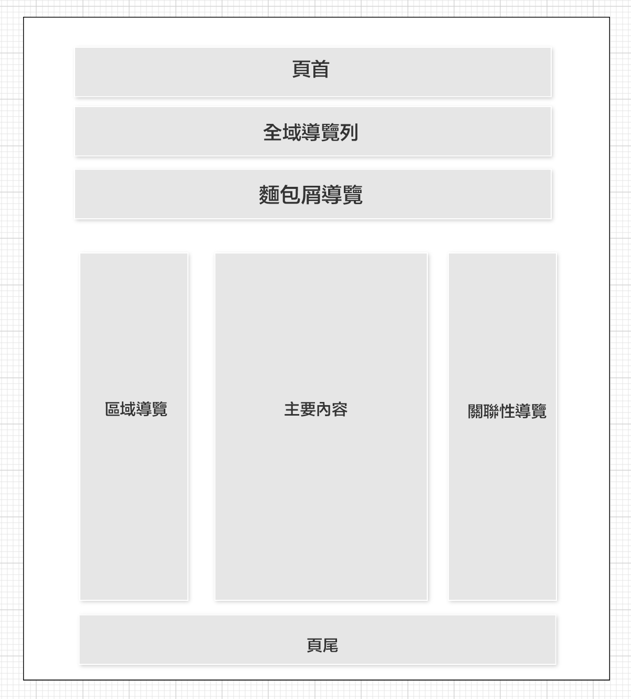

依照內容區塊的切分方式，基本版面可分成三種：

- **單欄式**（1 Column）
- **雙欄式**（2 Columns）
- **三欄式**（3 Columns）

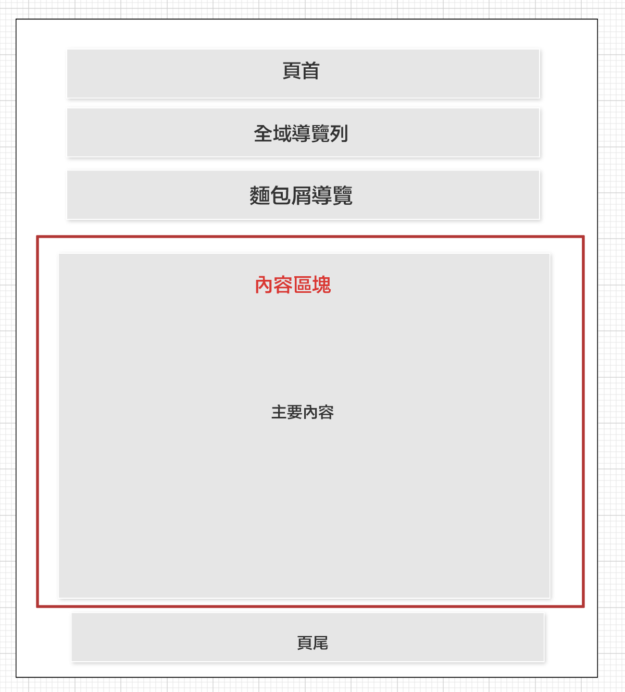

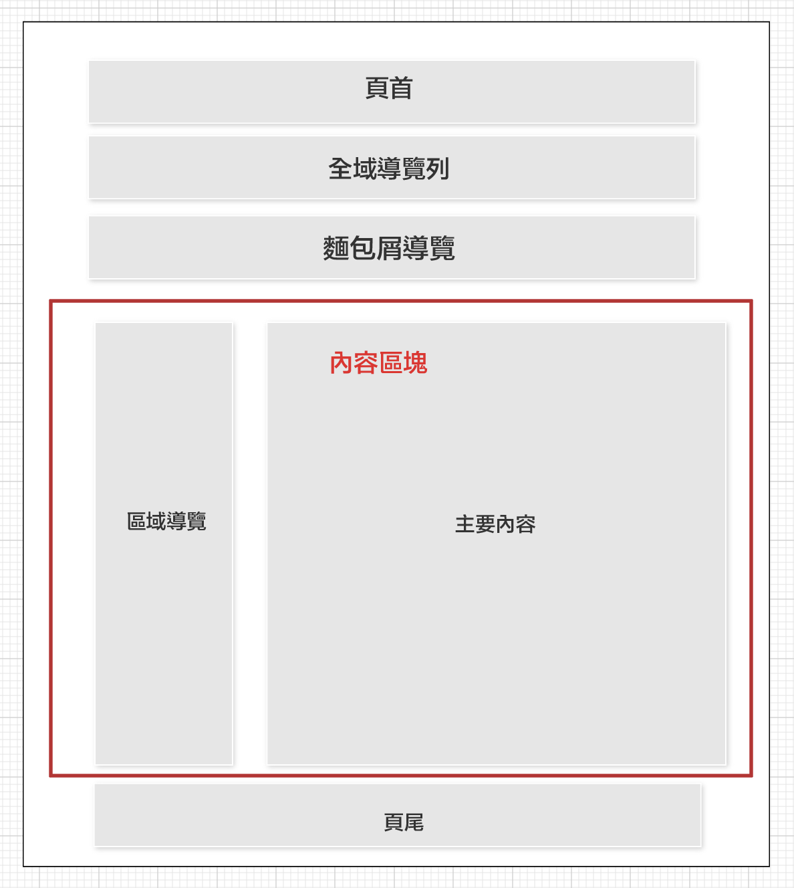

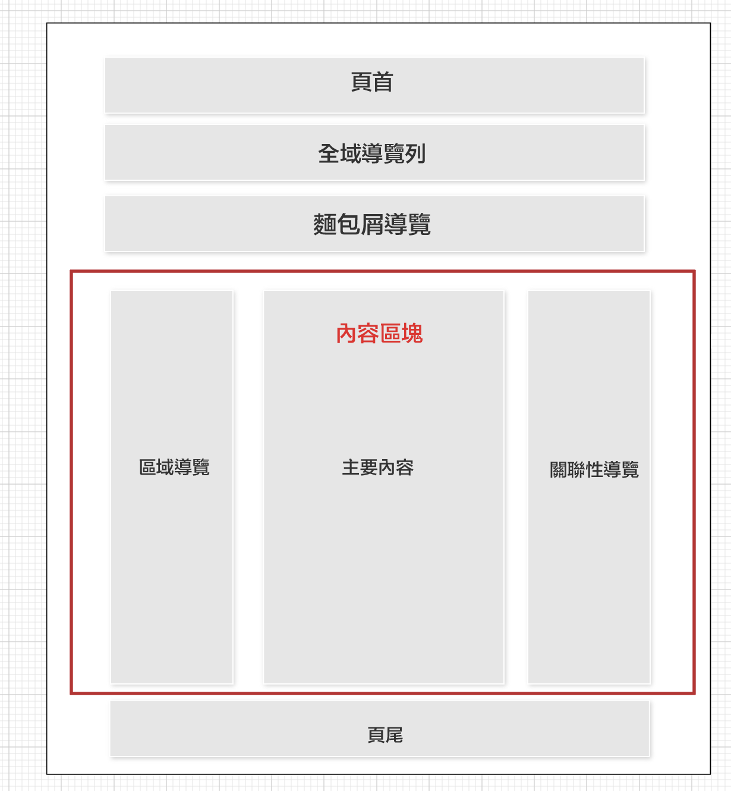

---

## 02 單欄式版型

### 常見且自由度高的版型

單欄式版型的版面不做任何分割，主要內容可以佔滿整個畫面寬度，因此版面設計幾乎不受限制，任何裝置都能瀏覽；尤其是智慧型手機、直向使用的平板電腦這類寬度較窄的裝置，更適合採用這種版型。

在電腦螢幕上，若想保留較寬的留白，或想明快、大膽地傳達網站訴求，單欄式也是非常合適的選擇。這種版型雖然沒有分欄，編排卻一點也不單純：例如 Apple 官網幾乎全部採用單欄式版型，卻能豐富且有魅力地呈現各種資訊。單欄式版型很考驗設計師的功力，也是最適合發揮視覺效果與創意的版型。

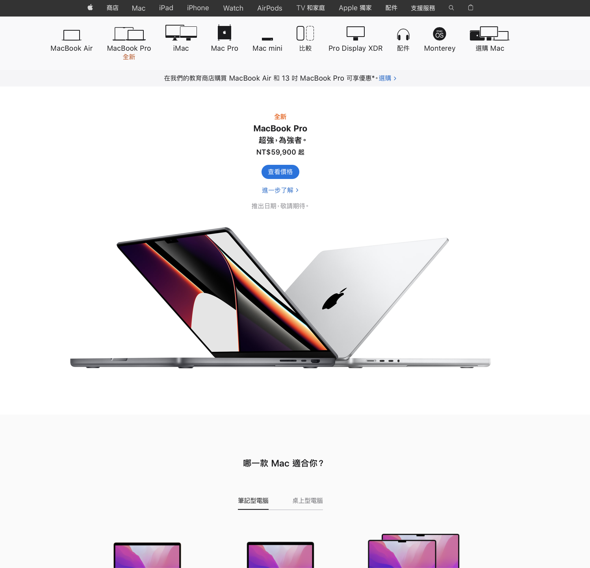

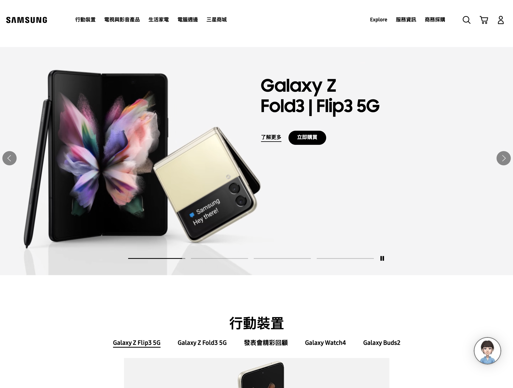

---

## 03 單欄式版型的各種變化

### 依照裝置特性的特殊編排

設計師會依據不同裝置、服務特性或輸入方式，設計出獨特的使用者介面；而介面越獨特，就越常選用單欄式版型。當然，雙欄式或三欄式版型一樣能滿足設計需求，但欄位越多，版面就越複雜，也越難突顯介面的獨特性與優勢。

[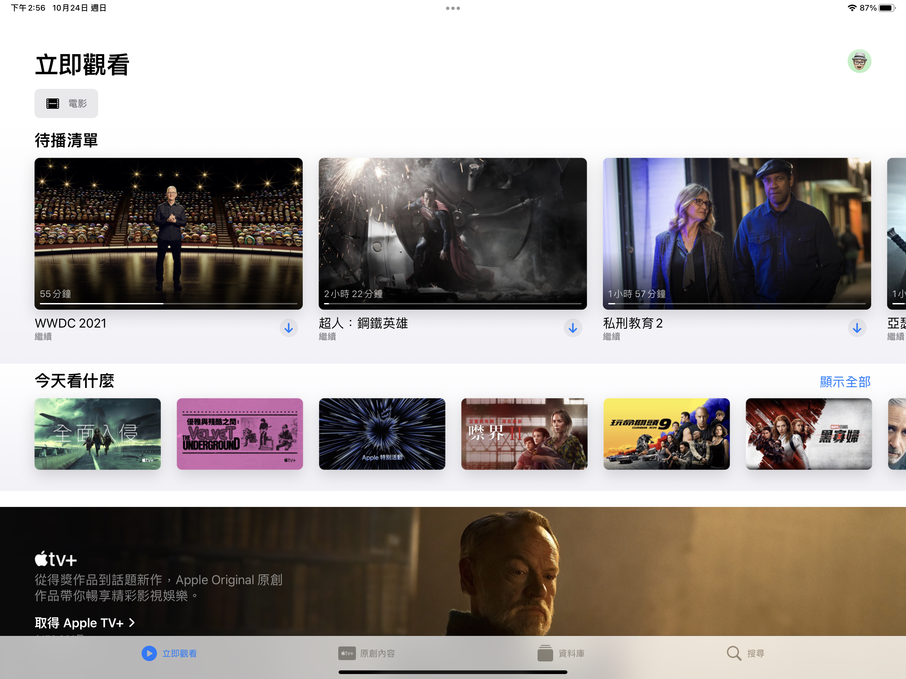](https://youtu.be/fvTS9pvEoZE)

---

## 04 雙欄式版型

### 擁有輔助區塊的便利版型

雙欄式版型是在主要內容旁邊多加一個 **輔助區塊**。輔助區塊的用途與位置可以隨網站或應用程式的功能調整，因此能提高版面設計的彈性。

輔助區塊中常放置「區域導覽列」「關聯性導覽列」等導覽元素，也可能放廣告、橫幅（Banner）、相關資訊、購買資訊或收藏功能，內容五花八門。其中，在輔助區塊放置導覽列特別能提升網站的實用性，也有助於提高點閱率與回訪率。撇開功能面不談，當內容不需要佔滿整個畫面寬度時，也常會選擇雙欄式版型來安排空間。

以平板電腦為主要裝置時，可以在直向畫面使用單欄式、橫向畫面改用雙欄式。這樣的巧思既能兼顧實用性，也能讓版面保持整齊美觀。

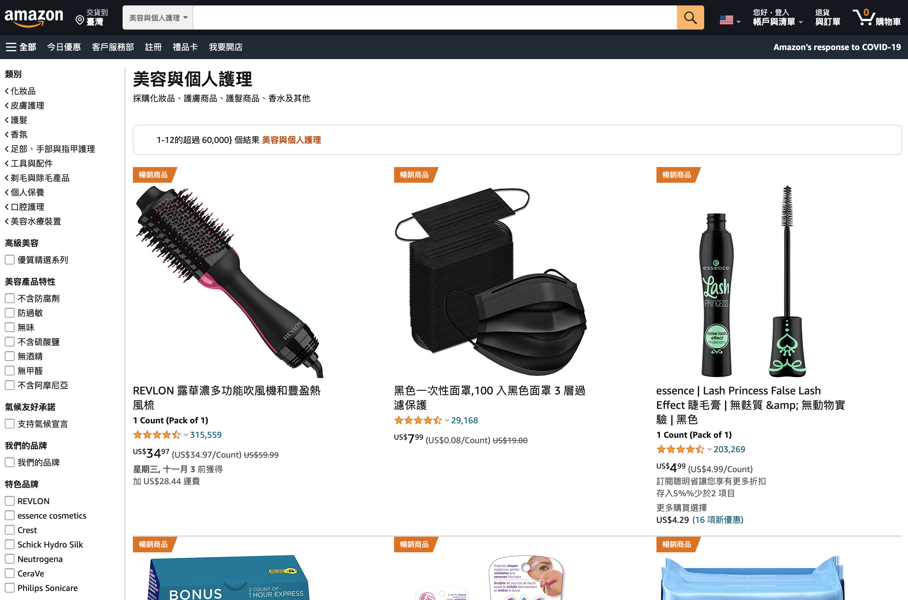

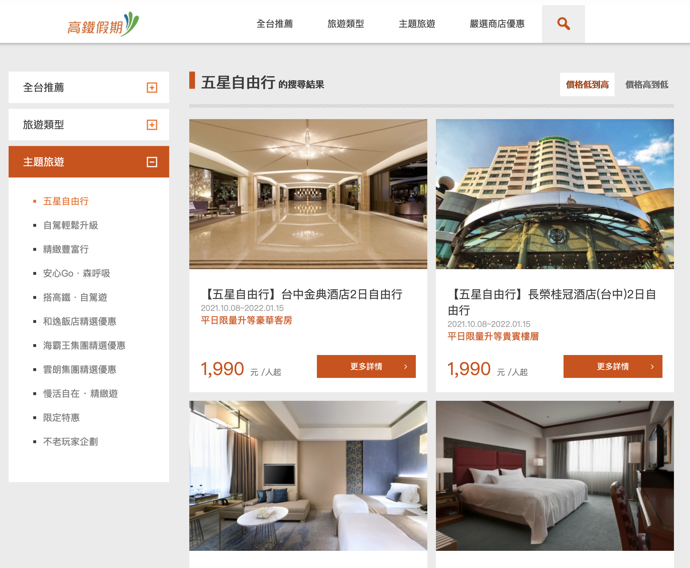

---

## 05 三欄式版型

### 便利性最高的版型

三欄式版型除了主要內容之外，還有兩個輔助區塊，是便利性最高、也最普遍的版型，傳統的電腦版網站尤其常用。常見的配置是左側放導覽列、右側放其他資訊；以文章為主的部落格網站，有時則會把主要內容放在左側，兩個輔助區塊都放在右側。

這種版型的限制在於需要足夠的畫面寬度。智慧型手機與直向的平板電腦並不適合瀏覽三欄式版面；換句話說，除非是在電腦或橫向平板上瀏覽，否則不太適合使用這種版型。

但只要瀏覽環境允許，就能像電腦版 Facebook 一樣，自由地在版面中配置廣告區塊或各種輔助資訊。

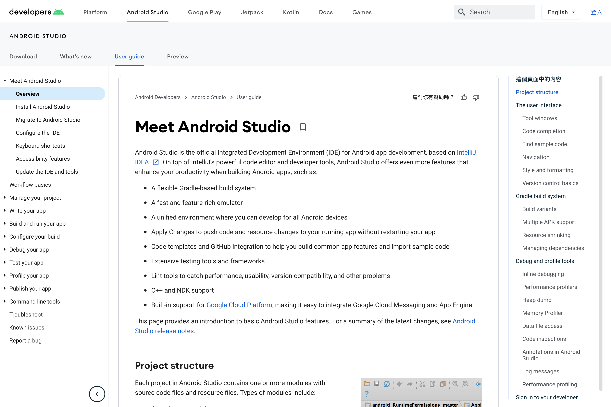

---

## 06 雙欄式版型與三欄式版型的變化

### 跨畫面實現雙欄式與三欄式

智慧型手機或平板電腦這類畫面尺寸受限的裝置，可以利用按鈕或滑動手勢，**跨畫面** 實現雙欄式或三欄式的版型。

雖然使用者要多點一下或多滑一次，但這比把所有資訊同時塞進畫面更方便：需要時立刻顯示，不需要時則暫時隱藏。這種手法最大的好處，就是能為小螢幕裝置省下大量空間；從開發角度來看，它原本更常見於應用程式，但如今網站也普遍採用。

手機版網站通常會把主要導覽列放在頁首或頁尾，但如果項目太多，就不適合放在這兩處。這時只要把選單設計成可滑出的面板，再把主要導覽項目放進去，就能提供同樣的便利性。

---

## 07 格狀設計

### 欄寬均等的版面

所謂 **「格狀設計」（Grid）**，是沿著垂直與水平排列的格線來配置元素的手法。由於每個區塊與資訊都排列得非常整齊，在邏輯上屬於穩定、且富有節奏感的版型。

網站與應用程式採用格狀版面時，通常會把每一欄設定成相同寬度，再以整數個欄位水平排列。常用的欄數有 4、5、6、8、10、12 等，而 960 正好是這些數字的公倍數，因此常被拿來當作版面的最大寬度。電腦螢幕這類尺寸較大的裝置，特別適合使用格狀設計。

---

## 08 回應式網頁設計

### 多元裝置時代的設計方法

所謂 **「回應式網頁設計」（Responsive Web Design，RWD）**，是依照裝置的畫面寬度，提供最合適版面的設計手法。它不是替每種裝置各準備一份 HTML，而是用 **同一份 HTML** 支援各種不同尺寸的裝置。

做法是設定幾個切換版面的畫面寬度，稱為 **「斷點」（Breakpoint）**，讓版面在斷點前後產生明顯的變化。若能進一步規劃好切換的基準，就能設計出更細緻的版型。不過回應式設計並非萬能，網站結構一旦太過複雜，就會很難兼顧。

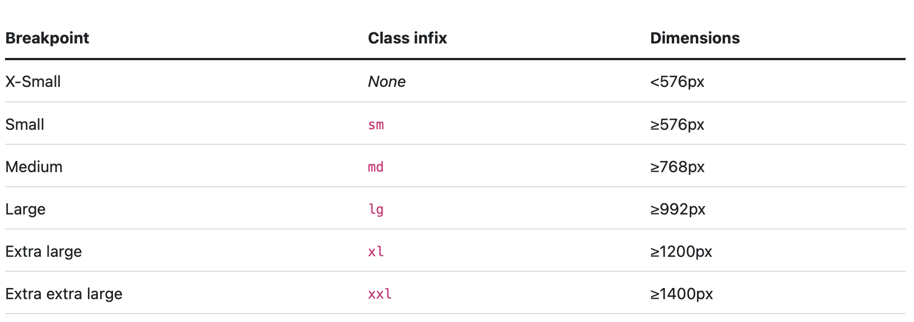

👉 參考範例：[Bootstrap Examples](https://getbootstrap.com/docs/5.1/examples/)

---

[⬅️ 返回網站架構觀念](../README.md)
