# 垂直、水平、前後的立體構造

> 每個觀念後面都有「🤖 用 AI 實作這個觀念」：把 Prompt 貼給 Claude、ChatGPT 或 Gemini，讓 AI 做出示範畫面，再對照觀念檢查它做得對不對。**看懂觀念，你才判斷得出 AI 做得好不好。**

---

## 01 連結帶來的影響

### 資訊的相關性

網站與應用程式和書籍、海報一樣，都是用來「呈現某些事物」的媒介；但兩者在本質上有一個關鍵差異：網站透過 **「連結」** 把不同的元素串聯起來，讓使用者可以在各元素之間來回移動。

不論是電腦、智慧型手機還是平板電腦，使用者在網站或應用程式中「從哪裡來、要往哪裡去」，都是由連結所產生的資訊相關性決定的。因此，網站與應用程式設計的關鍵，就在於 **「如何讓每個元素彼此串聯」**。

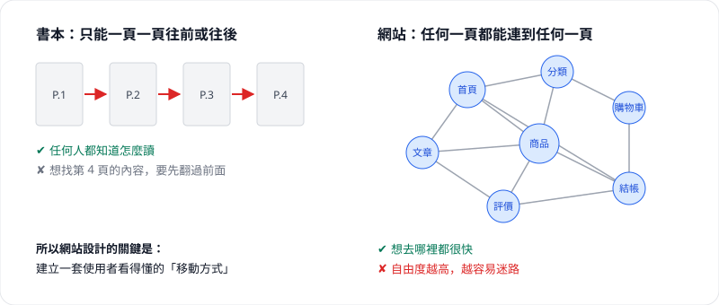

### 難用與難懂

書本只要一頁一頁往後翻，任何人都知道怎麼讀；網站則可以從任何一頁跳到任何一頁，自由度越高，使用者就越容易覺得難用、難懂。解決的方法，就是 **建立一套讓使用者能理解的操作方式**。

---

## 02 考慮垂直、水平、前後方向的立體構造

### 把網站想像成一個立體空間

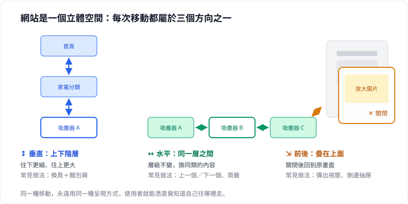

頁面之間的移動，可以想成是在一個立體空間裡朝三個方向前進：

| 方向 | 意義 | 常見例子 |
| :--- | :--- | :--- |
| **垂直（上下）** | 在階層之間移動，往下是更細的內容，往上是更大的分類 | 首頁 → 商品分類 → 商品詳細頁 |
| **水平（左右）** | 在同一階層之間移動，內容的層級不變 | 上一篇／下一篇文章、頁籤切換、同分類的其他商品 |
| **前後（深度）** | 在原本的畫面上「疊」一層新的內容，關閉後回到原畫面 | 彈出視窗、側邊選單、圖片放大檢視 |

設計網站時，若能先決定每一次移動屬於哪個方向，再用一致的方式呈現（例如：往下一層一律換頁、同階層一律用頁籤、補充資訊一律用彈出視窗），使用者就能憑直覺理解自己正往哪裡走。本章接下來介紹的「身在何處」「前後關係」「階層的廣度與深度」，都是建立在這個立體構造之上。

> [!TIP]
> 「前後」方向的各種做法，在 [無縫式介面](../無縫式介面/README.md) 一章有完整介紹與互動 demo。

### 🤖 用 AI 實作這個觀念

<details>
<summary>📋 Prompt：一個頁面同時用到三個方向</summary>

```text
請設計一個家電網站的「吸塵器商品詳細頁」（單一 HTML 檔案，桌機與手機都能看），
並清楚區分三種移動方向：
1. 垂直：頁面上方有麵包屑「首頁 > 家電 > 吸塵器 > 商品名稱」，點擊可回到上層。
2. 水平：頁面底部有「上一個商品／下一個商品」，切換同分類的其他吸塵器。
3. 前後：點商品圖片會在原畫面上方打開放大檢視（燈箱），按關閉或背景後回到原畫面。
請在頁面角落用小標籤註明每個區塊屬於哪一種方向，方便我檢查。
```

</details>

**看什麼：** AI 有沒有把「前後」做成新開一頁（那就變成垂直了）？上一個／下一個有沒有跳到別的分類（那就不是水平了）？

---

## 03 掌握身在何處的四個元素

### 讓使用者順利移動的四個元素

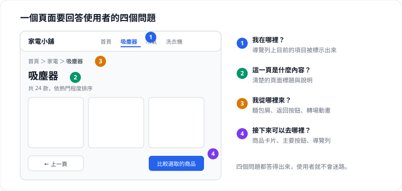

1. 現在位於哪一個頁面
2. 這個頁面的內容是什麼
3. 從哪裡來到這個頁面
4. 接下來可以前往哪一個頁面

使用者只要了解這四點，就能流暢地在各個頁面之間移動。即使有一兩點不太清楚，影響也不大；但如果四點全都不了解，就無法順利移動了。因為要在頁面之間移動，必須先了解頁面的前後關係，以及目前頁面在整個網站中的相對位置。

### 四個元素的表現方式（真實網站範例）

**1. 現在位於哪一個頁面** — 用標題和導覽列說明


**2. 這個頁面的內容是什麼** — 用標題和內容說明


**3. 從哪裡來到這個頁面** — 利用瀏覽器的「上一頁」，或利用互動效果呈現


**4. 接下來可以前往哪一個頁面** — 用導覽列和按鈕引導

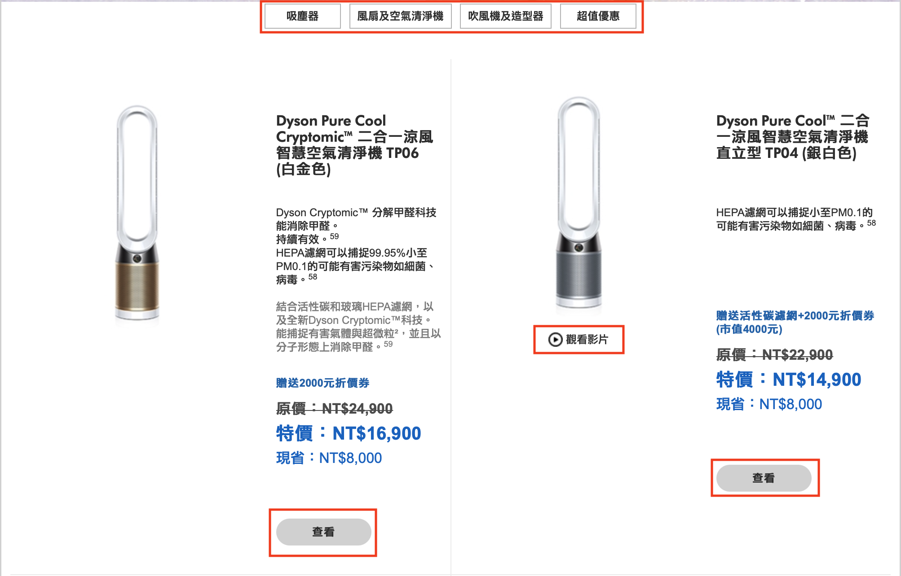

### 🤖 用 AI 實作這個觀念

<details>
<summary>📋 Prompt：做一頁，再請 AI 自己檢查四個元素</summary>

```text
請設計一個線上課程網站的「課程列表頁」（單一 HTML 檔案）。
完成後，請用表格檢查這一頁是否回答了使用者的四個問題，並指出是用哪個元素回答的：
1. 我在哪裡？　2. 這一頁是什麼內容？　3. 我從哪裡來？　4. 接下來可以去哪裡？
如果有任何一題沒有回答到，請修改頁面補上。
```

</details>

**看什麼：** 導覽列上「目前所在的項目」有沒有被標示出來？AI 常常忘記這一點。

---

## 04 讓頁面的前後關係視覺化

### 用視覺呈現「從哪裡來」

要說明「從哪裡來到這個頁面」，最直接的方法就是在畫面上直接顯示來源。例如 iOS 的手機與平板應用程式，為了讓使用者能回到上一個畫面，會在頁首左側放置一個標示著上一頁名稱的「返回」按鈕。

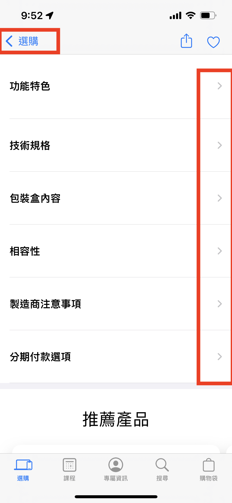

網站則因為瀏覽器本身就有「上一頁」按鈕，所以通常不需要另外設計類似 iOS 的返回功能。


### 利用頁面的變化量表現前後關係

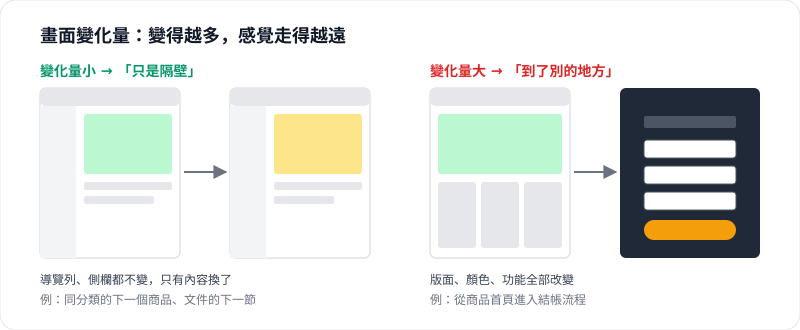

另一種較間接的表現方式，是利用換頁時畫面的 **「變化量」**。移動到下一個頁面時，可以把畫面元素全部換掉，也可以只換掉一部分。哪一種會讓人覺得「走得比較遠」？當然是全部換掉的那一種。

當頁面的結構與功能大幅改變，版面也會跟著不同，變化量自然就大；反之，如果下一頁的功能不變、只有部分內容改變，變化量就比較小。

**掌控頁面的變化量**，是一種讓使用者憑感覺就能理解前後關係的設計：變化量越大，使用者會覺得移動到越遠的地方；變化量越小，則覺得只是移動到附近。只要掌握前後頁面的變化量，使用者就能感受到頁面之間的距離，也能理解各頁面扮演的角色有什麼不同。

#### 變化量小的網頁（真實範例）

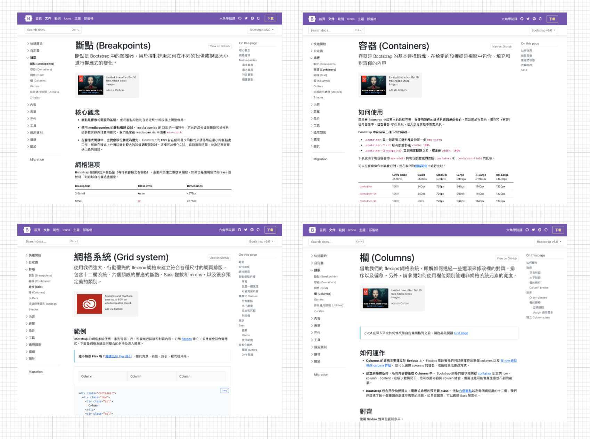

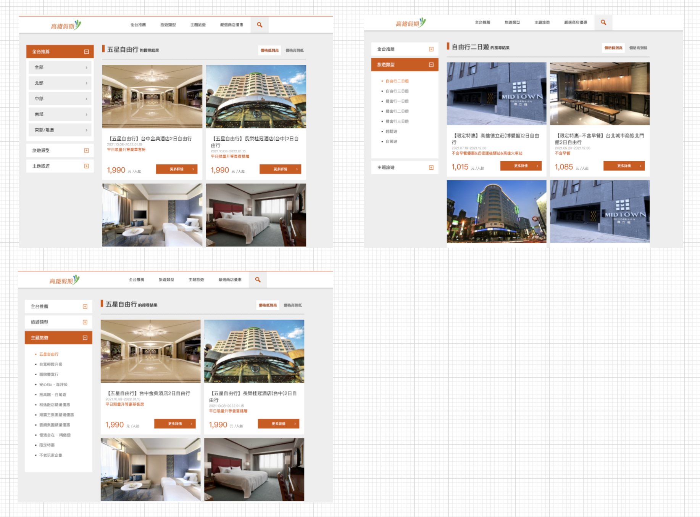

### 🤖 用 AI 實作這個觀念

<details>
<summary>📋 Prompt：同一個網站，做出變化量小與變化量大的頁面</summary>

```text
請為一個咖啡豆網站設計三個頁面（每頁一個 HTML 檔，彼此可以點擊切換）：
1. 商品頁「衣索比亞淺焙」
2. 商品頁「哥倫比亞中焙」：和第 1 頁的導覽列、版面完全相同，只換照片、名稱與說明（變化量小）
3. 結帳頁：拿掉一般導覽列、改成簡化的頁首與步驟條，版面與重點顏色明顯不同（變化量大）
讓我點擊切換時，能感受到「隔壁」與「到了別的地方」的差別。
```

</details>

**看什麼：** 在兩個商品頁之間切換時，導覽列有沒有「跳動」？如果有，變化量就不夠小。

---

## 05 利用互動性表現頁面的前後關係

### 直覺地理解前後關係

**互動性（Interaction）** 的設計也能讓使用者明白「從哪裡來到這個頁面」。所謂互動性，就是對使用者的操作做出反應；在換頁時加上簡單易懂的轉場效果或動畫，就能讓使用者看出移動的路徑。

以 iOS 的「設定」畫面為例，進入下一層時畫面會從右側滑入，返回時則往右滑出（另外也有縮放等多種呈現方式），營造出上下階層的感覺。之所以在手機的設定畫面或應用程式中花這麼多心思設計轉場，就是為了讓使用者了解移動的方向，以及目前頁面與前後內容的關係。

傳統網站的每個網址都是獨立的頁面，換頁時整個畫面會重新載入，因此比較難套用這類互動設計；手機與平板的應用程式則很適合用轉場效果來表現「換頁的路徑」。不過隨著前端技術進步（例如瀏覽器的 View Transitions 功能），網站也越來越能做到這種效果（參考 [無縫式介面](../無縫式介面/README.md)）。

[](https://youtu.be/jQTc4ubMfqc)

[](https://youtu.be/PfQ8LRpqi9o)

### 🤖 用 AI 實作這個觀念

<details>
<summary>📋 Prompt：用轉場動畫表現「往下一層」與「回上一層」</summary>

```text
請做一個手機版的「設定」畫面原型（單一 HTML 檔，用 JavaScript 切換畫面，不換頁）：
第一層：設定列表（通知、隱私、帳號、關於）。
點擊任一項目時，第二層從右側滑入；按左上角「‹ 設定」返回時，第二層往右滑出。
動畫時間約 250 毫秒，並尊重系統的「減少動態效果」設定（prefers-reduced-motion）。
```

</details>

**看什麼：** 進入與返回的方向是不是相反的？如果兩個方向都一樣，使用者就分不出是「往下」還是「往回」。

---

## 06 讓使用者透過視覺設計判斷目前所在位置

### 「看一眼」就知道的差異

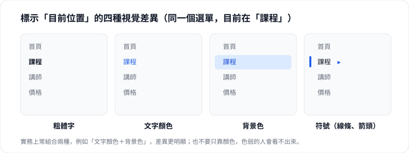

目前所在的位置、所屬的分類、正在瀏覽的項目，都可以用一眼就能看懂的 **「視覺差異」** 告訴使用者。如此一來，使用者就能直覺地掌握自己在哪裡、身處哪個大分類，也更清楚接下來可以「往哪裡去」。

視覺差異的設計大致可分成四種：

- **粗體字**：將文字設為粗體
- **文字顏色**：替文字換上不同的顏色
- **背景色**：在背景鋪上色塊
- **符號**：加上箭頭、底線等標記

實際使用時通常會組合搭配，例如「文字顏色＋背景色」或「粗體字＋符號」，讓差異更加明顯。

不過，可用的差異種類和組合方式都有限，如何巧妙地組合這些視覺差異，是頁面設計的關鍵，也會大幅影響網站的易用性。

#### 真實網站範例


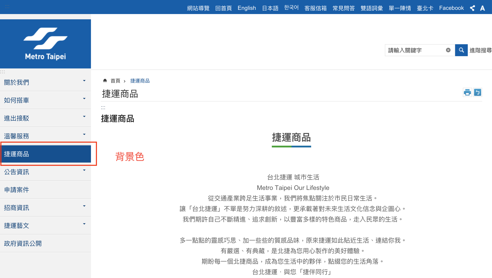


### 🤖 用 AI 實作這個觀念

<details>
<summary>📋 Prompt：比較四種標示方式</summary>

```text
請做一個比較頁（單一 HTML 檔），並排展示同一個側邊選單（首頁、課程、講師、價格、常見問題），
目前位置都是「課程」，但分別用不同方式標示：
1. 只用粗體　2. 只用文字顏色　3. 只用背景色　4. 左側直線＋粗體（組合）
每一個下面註明優缺點。另外再做一個「灰階版本」，讓我看看色弱的使用者還分不分得出目前位置。
```

</details>

**看什麼：** 在灰階版本中，「只用文字顏色」那一個是不是幾乎看不出來？這就是為什麼不要只靠顏色。

---

## 07 階層的廣度、深度與標籤的關係

### 要又深又窄，還是又淺又廣？

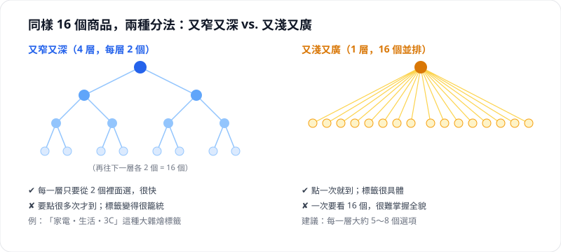

階層的 **「深度」** 與 **「廣度」** 成反比。把同樣多的資訊放進一個網站時，階層設計得越「深」，每一層的選項就越「窄」；反之，階層設計得越「淺」，每一層的選項就越「廣」。

雖然視情況而定，但一般來說，「又窄又深」的階層比「又廣又淺」的階層好用。原因之一是：在階層之間上下移動，比在同一層的一大堆選項中逐一瀏覽來得省力。但影響更大的，其實是 **每一層的標籤是否簡單易懂**。

### 標籤必須具有排他性

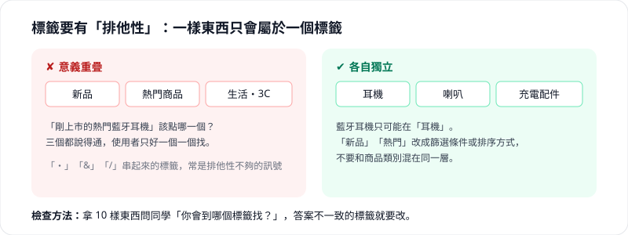

所謂 **「標籤」（Label）**，就是每個項目的名稱。為了不讓使用者迷路，每個標籤都必須有獨立、明確的意義，也就是 **具有排他性**：使用者看到兩個標籤，不會搞不清楚某樣東西該放在哪一個底下。

階層又窄又深時，每個標籤需要涵蓋更多項目與概念，於是常會出現用「&」、「・」或斜線「/」把好幾個詞串在一起的標籤。反過來說，階層又淺又廣時，標籤的意義通常更具體、也更具排他性。


### 三者互相牽制

但階層若又淺又廣，使用者就很難掌握資訊的全貌。一般認為人一次能處理的資訊量有限（常被引用的說法是「7 個左右」），因此每一層的選項大約控制在 **5～8 個**，會是比較好用的設計。

總結來說，階層的 **「深度」「廣度」與「標籤」** 三者互相牽制。設計網站與應用程式時，必須依照用途在這三者之間取得平衡。


### 🤖 用 AI 實作這個觀念

<details>
<summary>📋 Prompt：請 AI 整理網站的分類架構</summary>

```text
我要做一個社區型的手作市集網站，會有大約 60 種商品與服務：
（貼上你的清單，或請 AI 先幫你列出可能的 60 項）
請幫我規劃網站的分類架構：
1. 用樹狀圖列出各層分類，每一層控制在 5～8 個選項，最多 3 層。
2. 每個分類標籤都要具有排他性，不要使用「・」「&」「/」串起好幾個詞。
3. 列出 5 個「可能放在兩個分類都說得通」的商品，並說明你最後放在哪裡、為什麼。
4. 最後做一個導覽選單的 HTML 原型，讓我可以實際點點看。
```

</details>

**看什麼：** 拿 AI 列出的 5 個「模糊」商品，問三位同學「你會去哪個分類找？」，答案不一致的分類就要改名或重新分。

---

[⬅️ 返回網站架構觀念](../README.md)
