# 導覽列

## 01 導覽列扮演的角色

### 達成目的的手段

導覽列是提供給使用者的一套 **操作體系**：它讓使用者了解頁面之間的位置關係與移動方式，而且操作方式前後一致。設計精良的導覽列能提醒使用者目前在哪個頁面，也讓使用者知道接下來還能去哪裡，進而感受到網站或應用程式的價值。

只要知道目前所在的頁面，就能理解這個頁面與其他頁面的關係。反之，如果使用者是從其他管道進入頁面，頁面與網站其他部分的關聯就可能斷掉，使用者也就很難理解頁面的內容。最典型的例子，就是從搜尋引擎直接進入網站深處的某一頁。導覽列不只說明目前所在位置，也幫助解釋頁面內容的意義，因此它和頁面標題一樣重要。

設計者很容易以為使用者會直線朝目標資訊前進，但事實並非如此。透過搜尋引擎進入深層頁面後，使用者可能經由分類頁前往其他頁面，也可能改用關鍵字搜尋或導覽列，行為模式非常多元。因此，導覽列必須設計得更有彈性，才能應付使用者難以預期的行為。

只要導覽列好用，所有操作都會變得流暢。**最理想的導覽列，是讓使用者忘記它的存在**——因為使用者是為了達成某個目的才來到網站，導覽列只是在一旁協助他們達成目的的手段。

---

## 02 不同類型的導覽列區塊

### 負責引路的導覽列

導覽列不只是讓使用者在頁面之間移動的機制，也負責 **引路**。有時使用者需要知道自己到底在網站的哪裡，因此放置導覽列的區塊除了提供換頁功能，還必須依各自的角色 **固定在網頁的特定位置**，使用者才能掌握目前所在位置。

放置導覽列的區塊由 **「頁首」「全域導覽列」「麵包屑導覽」「區域導覽列」「關聯性導覽列」「頁尾」** 組成，「主要內容」則是該頁面的主要資訊。

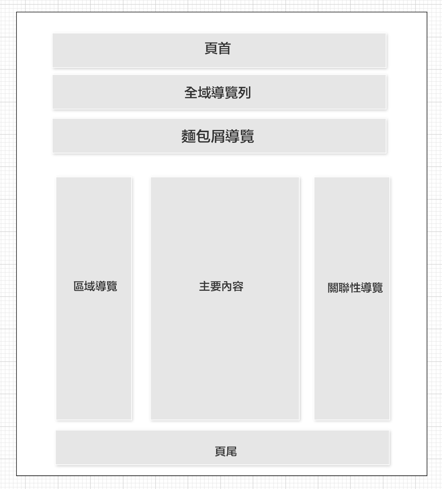

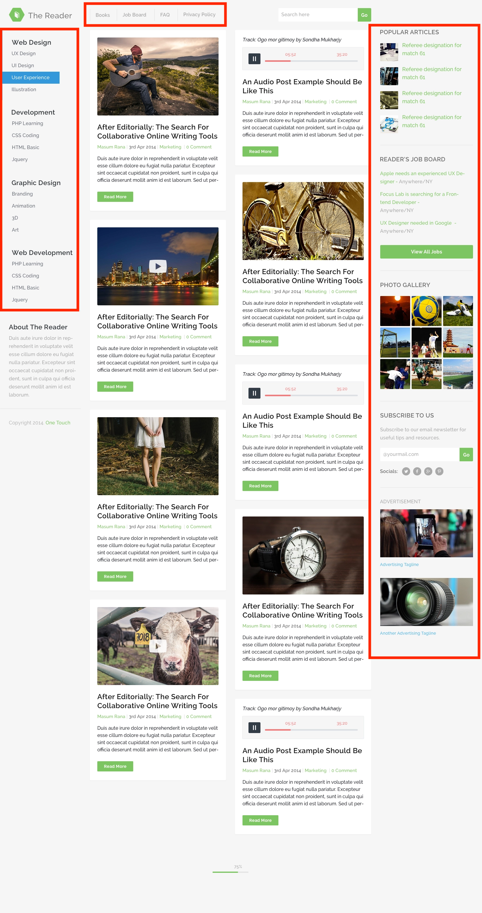

智慧型手機與平板電腦這類畫面有限的裝置（尤其是手機），能使用的導覽列區塊非常有限，不能隨意放太多個。導覽區塊應該採用上下堆疊而非左右並排，或改用可左右滑動的互動方式。總之，必須在導覽列的結構與編排上花更多心思。

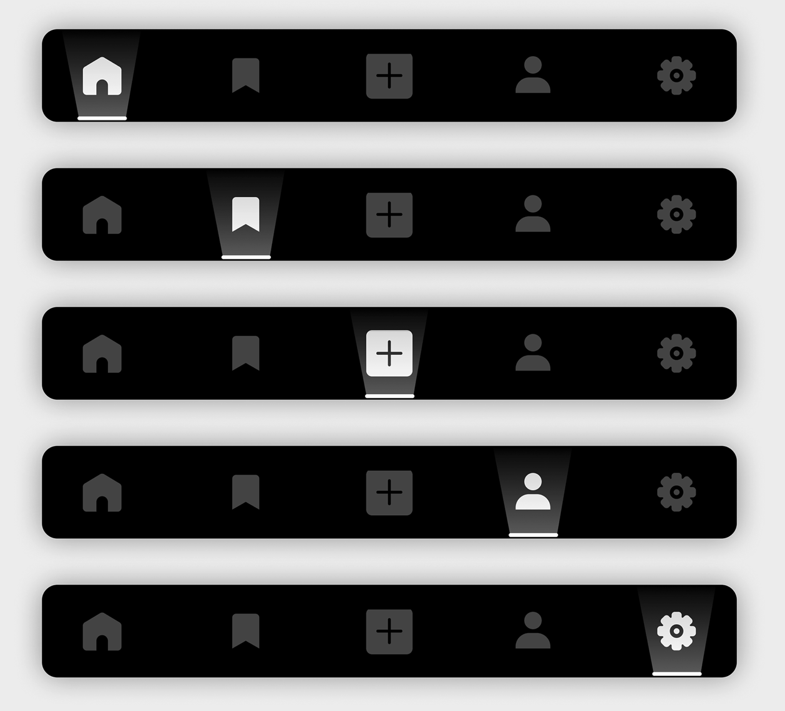

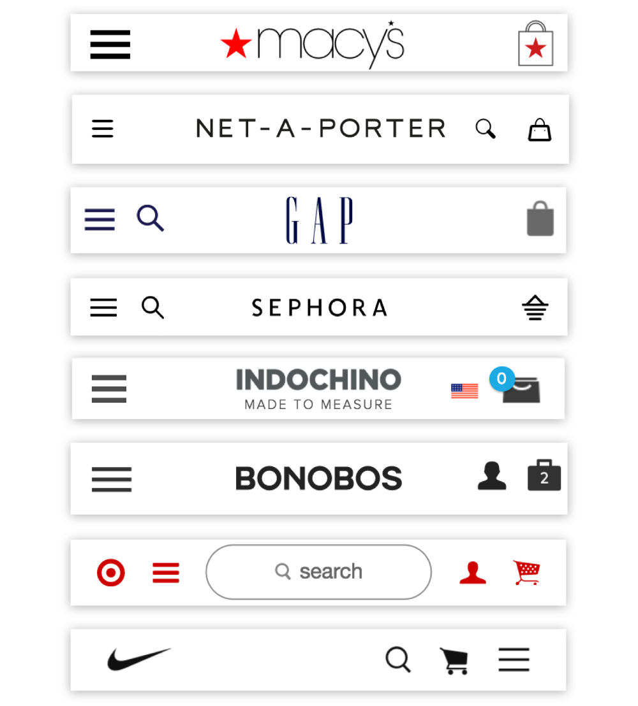

---

## 03 常駐於畫面的「頁首與頁尾」

### 貫穿整個網站的共通區塊

**頁首與頁尾** 基本上會出現在每一個網頁，是讓所有頁面共享相同功能的共通元素。頁首通常放置 Logo、搜尋等與網站品牌相關的功能；頁尾則放置使用條款等規範性資訊，以及輔助的導覽連結。

近年來，頁首與頁尾變得越來越重要。畫面較窄的智慧型手機特別需要在這兩個區塊放置導覽；即使是其他裝置，也不能忽視頁首與頁尾作為導覽列的潛力，尤其是在使用 **「大型下拉式選單」（Mega Drop-down Menu）** 或 **「網站地圖式頁尾」** 的時候。

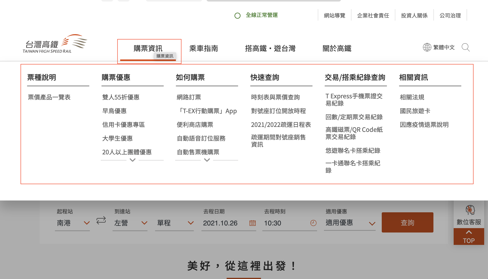

### 階層化的整體俯瞰圖

**大型下拉式選單**，是以「一整個區塊」展開的下拉選單，通常放在頁首或全域導覽列中。滑鼠移入或點擊時，會立刻展開一個大型選單；為了讓所有選項分組呈現，這種選單通常設計成不需要捲動，讓使用者一次看到所有選項。

**網站地圖式頁尾**，則是在頁尾放入簡易版網站地圖、份量十足的頁尾區塊。因為位於畫面最下方，即使範圍很大也不會干擾主要內容；使用者讀到頁面最後時，也不必再捲回最上方，就能直接前往其他頁面。

大型下拉式選單與網站地圖式頁尾的設計目的相同：**「讓使用者了解網站全貌，隨手一點就能前往目標頁面」**。這比另外製作一個網站地圖頁面更方便，也能讓使用者在不中斷思緒的情況下切換頁面。

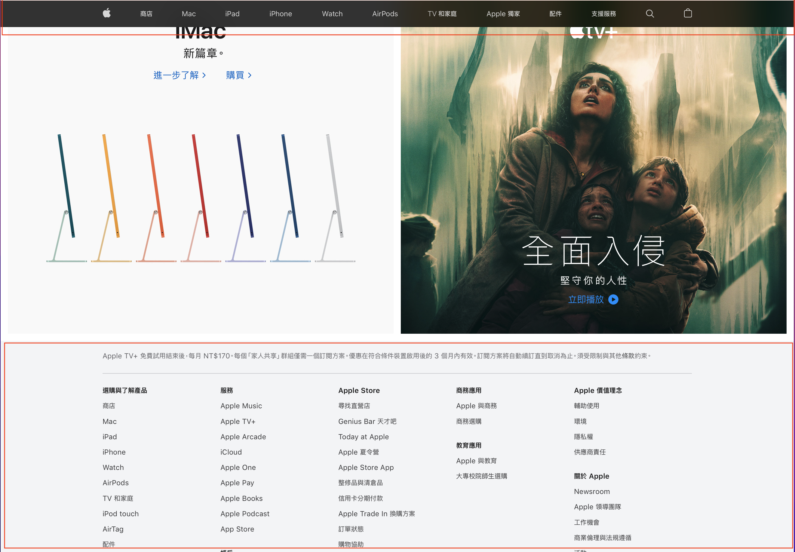

---

## 04 代表位址與路徑的「麵包屑導覽」

### 具有輔助效果的文字資訊

**麵包屑導覽（Breadcrumb）** 代表網頁在網站中的 **位址與路徑**，也稱為「麵包屑列表」或「麵包屑導覽列」。所謂位址，是指該網頁相對於網站起點「首頁」的位置；路徑則是從首頁到達該網頁的脈絡。

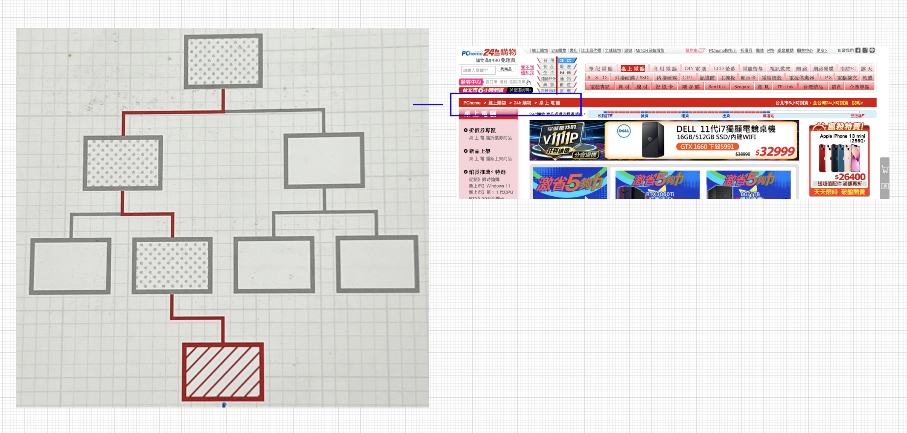

麵包屑導覽通常扮演輔助角色，與全域導覽列或區域導覽列搭配使用。它和區域導覽列的關係特別密切，因為兩者呈現的階層結構會有部分重疊；如果兩者不一致，反而會妨礙使用者掌握目前位置。因此，在協助使用者掌握位置（或路徑）之前，必須先決定 **以麵包屑導覽還是區域導覽列為主要依據**。

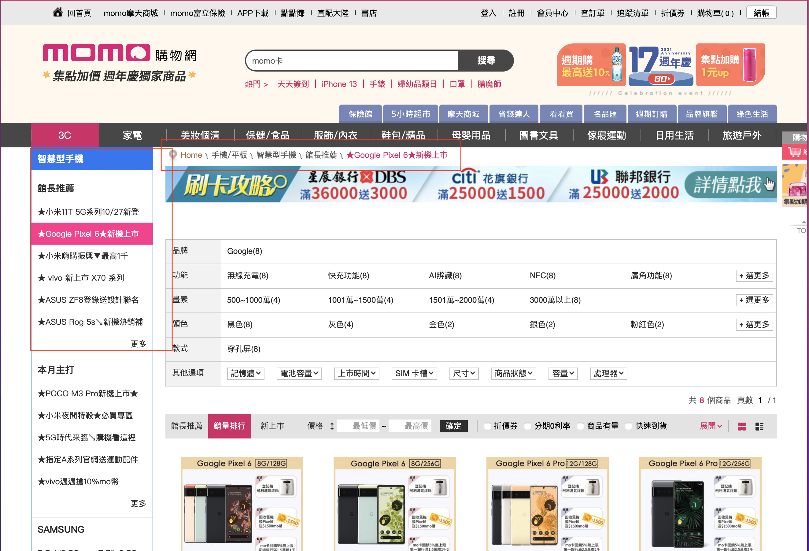

雖然麵包屑導覽通常只是輔助，但對於畫面太小、不方便放置全域或區域導覽列的裝置來說，它卻是非常重要的導覽工具；尤其在畫面很窄的智慧型手機上，麵包屑導覽更能發揮很大的作用。

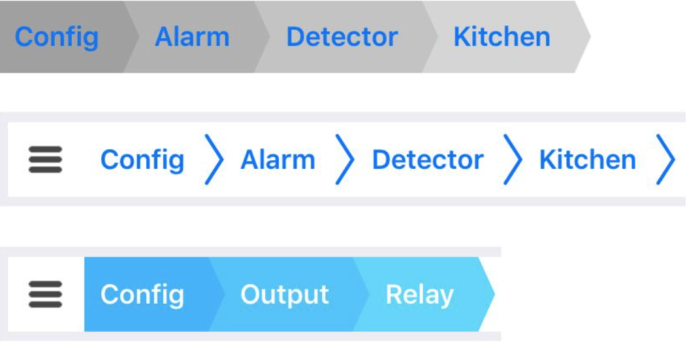

---

## 05 不同類型的「麵包屑導覽」

### 路徑不只一條時該怎麼辦？

麵包屑導覽代表的是「位址」或「路徑」，但如果到達某個頁面的路徑不只一條，該怎麼呈現呢？網站規模越大，越容易遇到這個問題，尤其是一個頁面有多個上層分類時更明顯。例如「iPod touch」這項商品，可以同時屬於「影音設備」「行動裝置」「Apple 產品」等分類，而且在不同情境下各有道理。

也就是說，一個頁面可以同時擁有多個上層頁面，因此麵包屑導覽的呈現方式可分成以下三種：

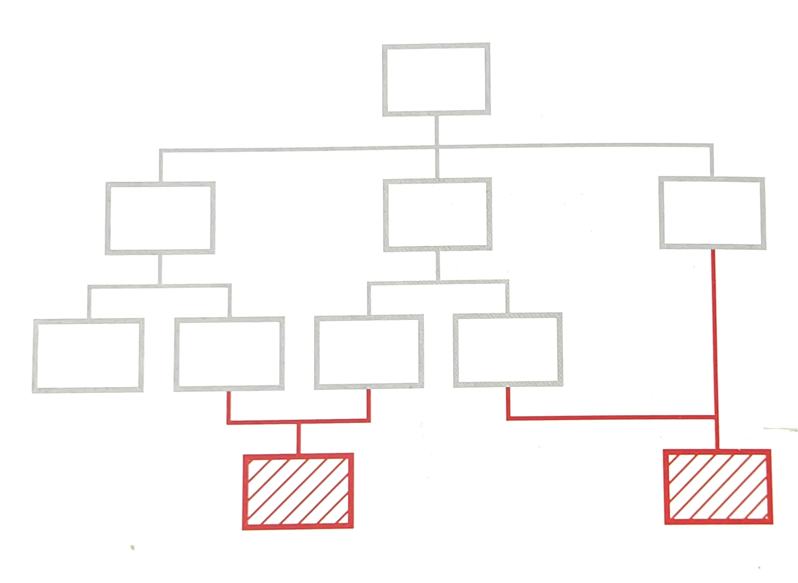

#### 優先型

固定顯示一條麵包屑導覽。不論從哪條路徑到達，頁面都只顯示同一條麵包屑，等於讓每個頁面只有一個位址；缺點是無法反映使用者實際走過的路徑。

#### 複數型

同時顯示多條麵包屑導覽。雖然能明確列出所有可能的路徑，卻看不出使用者是從哪一條來的；而且同一個頁面擁有多個位址，會讓人覺得奇怪，麵包屑也容易變得冗長。

#### 變動型

依照使用者實際走過的路徑切換麵包屑內容。可以參考上一頁的資訊，或依照網址中的參數來切換。由於是動態切換，實作難度也比較高。

---

## 06 「全域導覽列」與「區域導覽列」

### 代表結構與位置關係的主要導覽

**全域導覽列** 與 **區域導覽列** 代表了網站或應用程式的基本結構，也是所有導覽列中的主角。在兩者上標示目前所在位置，就能呈現目前頁面與整個網站的相對關係；它們同時也是使用者以一致的方式前往目標頁面的移動工具。

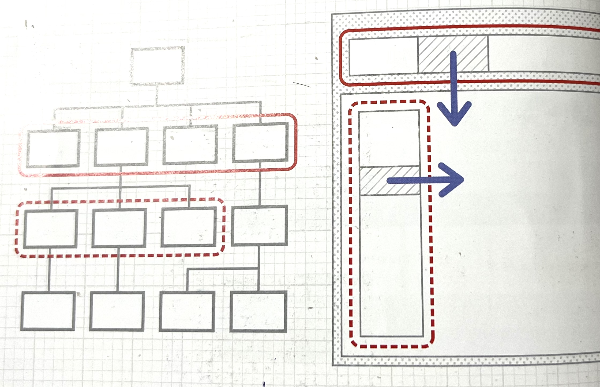

電腦版網站通常會在每個頁面同時放置全域導覽列與區域導覽列。為什麼「全域＋區域」兩段式的導覽會這麼普遍？原因有二：一是 **主要導覽列越多，雖然越便利，複雜度也越高**；二是 **畫面是平面的，垂直方向放一個、水平方向放一個，最容易規劃空間**。

因此，雖然理論上與實務上都能在畫面中放三個以上的導覽列（例如「水平＋垂直＋水平」交錯排列，或三條水平導覽列層層堆疊），但一般來說，還是不會在同一個畫面中放置三個導覽列。

智慧型手機等畫面尺寸受限的裝置，有時很難同時放置全域與區域導覽列。尤其手機實際上只能在一個方向放置一個導覽列，因此通常只放全域導覽列，而無法另外放置區域導覽列。

---

## 07 讓使用者從他處回流的「關聯性導覽列」

### 跳到其他相關頁面

**關聯性導覽列** 與網站結構、目前所在位置都沒有直接關係，而是在使用者看完頁面內容後，引導他前往其他相關頁面。具體來說，像是「這個商品分類的常見問題請點此」這類相關資訊連結，或是「瀏覽此頁的人也看了這些頁面」這類推薦功能。

關聯性導覽列不包含任何表示位置關係的元素，只是承接主要內容、提供前往其他頁面的入口，因此通常放在畫面右側、內容結尾或區域導覽列下方等不太顯眼的位置。此外，關聯性導覽列也常混入橫幅、廣告、篩選功能等繁雜的資訊，本來就不希望太引人注意。

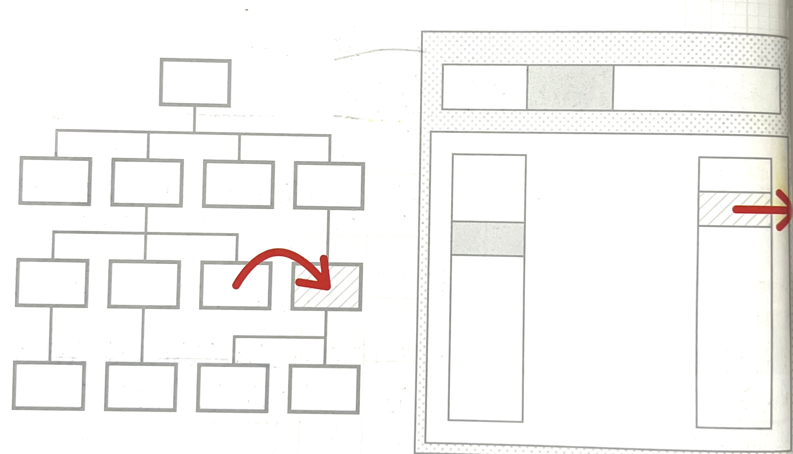

話雖如此，關聯性導覽列的用法與設計，仍可能影響整個網站的方向，絕對不能忽視。例如 Amazon 的關聯性導覽列，就提供了讓使用者覺得很有價值的連結與資訊。

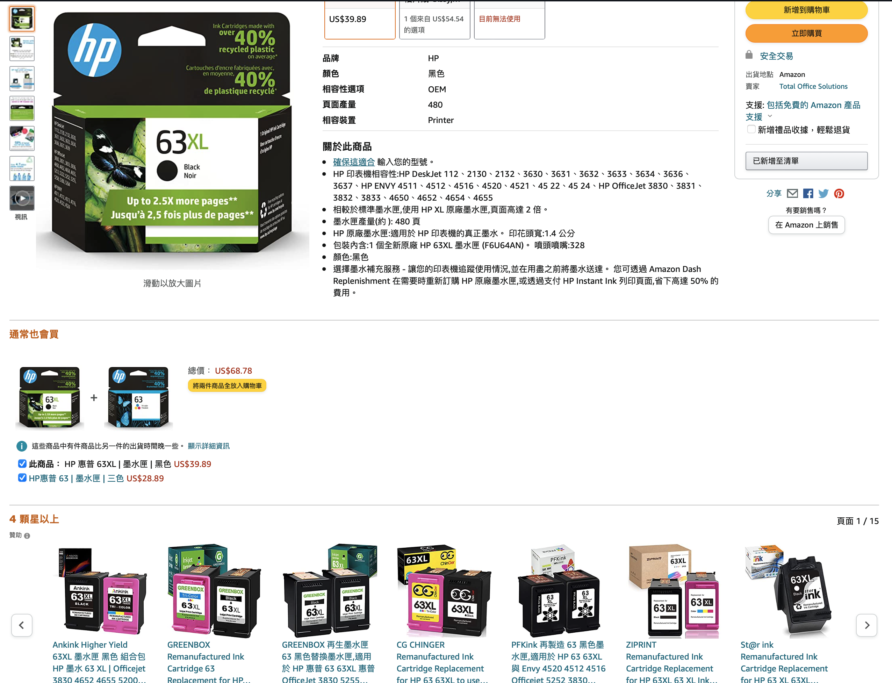

---

## 08 垂直型與水平型的「區域導覽列」

### 各有特色的兩種類型

區域導覽列可分成 **「垂直型」** 與 **「水平型」** 兩種，各有優缺點。

**垂直型** 通常出現在雙欄式或三欄式版面中，位於主要內容的左側或右側。區域導覽列的一大功能，是讓使用者透過階層結構了解目前所在位置，而垂直型在這方面表現較好；選項較多時，垂直排列也能容納更多項目。缺點是會佔據畫面左側或右側的整條空間，等於壓縮了主要內容的寬度。

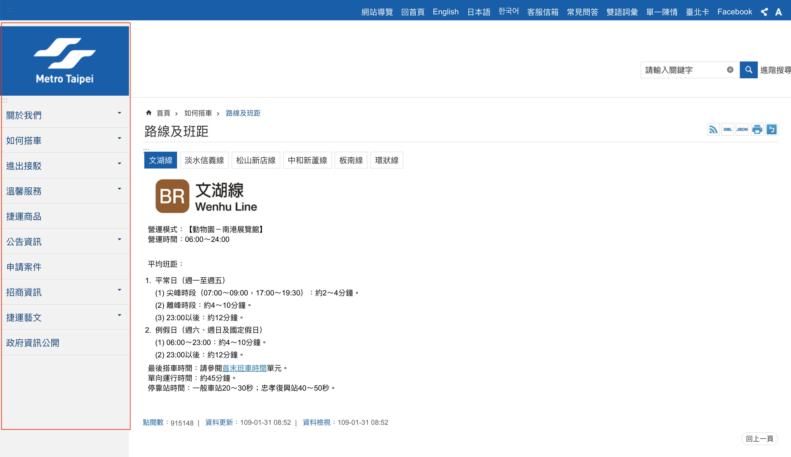

**水平型** 只顯示同一階層的選項，一眼就能看到所有選項，設計精巧，也不會壓縮主要內容的空間。缺點是可用寬度會隨裝置的畫面大小改變，能放的選項非常有限；而且只能顯示同一階層，使用者很難看出網站的整體結構。

因此，該選用哪一種，要看網站的階層深度、分類數量，以及主要內容需要多少空間而定。如果網站階層很深、資訊量又非常龐大，也可以同時使用水平型與垂直型的區域導覽列。

---

## 09 透過「區域導覽列」顯示的階層

### 只顯示下層，還是同層＋下層？

當導覽結構是階層式時，區域導覽列的顯示方式大致可分成兩種：

- **「只顯示下層」型**：只列出目前所在位置的下一層項目
- **「同層＋下層」型**：列出目前所在位置的同一層項目，以及下一層項目

**「只顯示下層」型** 能透過階層說明連結之間的相對位置，也能透過區域導覽列「往下一層」移動。但因為無法在同一層之間移動，使用者必須先回到上一層，才能再進入其他的下層頁面。

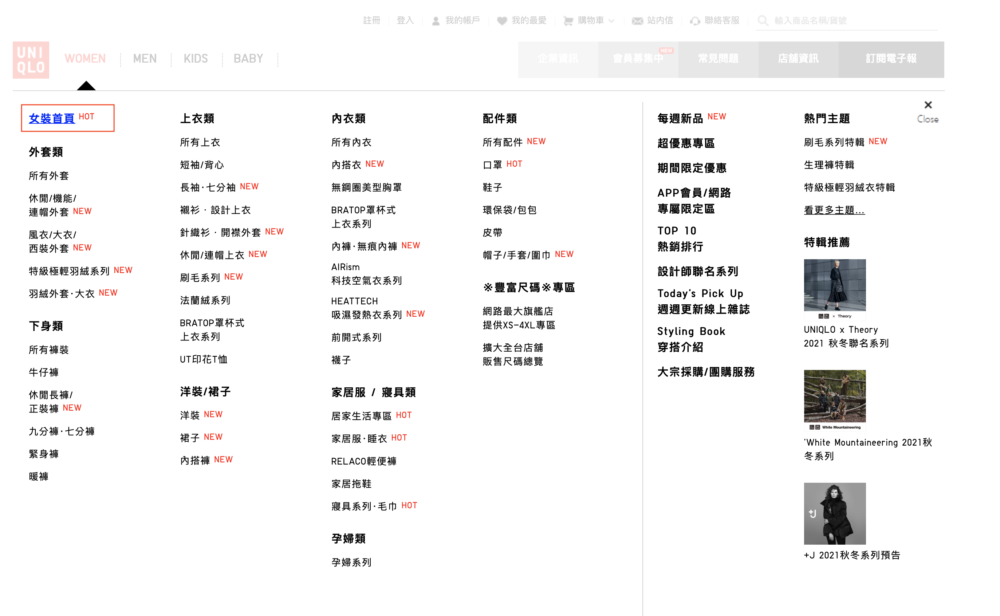

**「同層＋下層」型** 除了顯示階層的相對位置，也能透過區域導覽列在 **同一層之間** 移動，因此使用者更容易在相關頁面之間來回瀏覽（回流性較高）。相對地，就得在「往下一層移動」這點上多花心思：可以在同層連結底下加上下層連結，或利用主要內容區塊中的連結往下一層移動（水平型區域導覽列在結構上必須採用同層顯示）。這是便利性高、但較缺乏變化的結構。

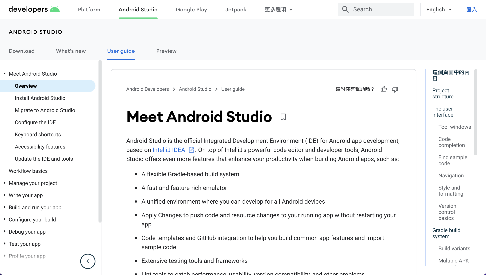

---

## 10 「樹狀型區域導覽列」的位置

### 放左邊還是右邊？

區域導覽列放在網站左側是目前的主流，不過曾有一段時間流行放在右側。當時的理由包括：主要內容放在左側比較容易被看到；主要內容的右側被截斷不好看；能提升 SEO（Search Engine Optimization，搜尋引擎最佳化）的效果；或是單純覺得這樣比較與眾不同。

隨著搜尋引擎進步、各家瀏覽器都能正確顯示 CSS 版面，右側導覽列已不再具有 SEO 上的優勢。儘管其他優點仍在，右側導覽列已不像過去那麼常見。原因之一是：右側導覽列在展開階層結構時看起來不太自然，樹狀型的區域導覽列尤其明顯。

### 順著文字的閱讀方向配置

無論中文、英文還是日文，網頁上的文字大多是由左至右閱讀，因此表示階層的「縮排」也應該放在文字左側；區域導覽列的階層結構，自然也應該是由上而下、由左至右展開。如果把區域導覽列放在右側，視線移到畫面最右邊後，又得大幅移回左側才能繼續閱讀主要內容，這種視線流動並不自然，會讓閱讀變得吃力。

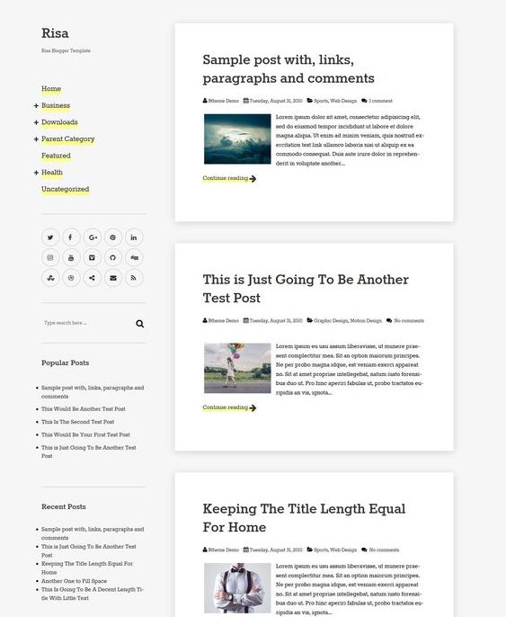

**區域導覽列的角色，是說明網站內部的階層結構與目前所在位置**，因此讓使用者在閱讀內容之前先看到它，才是自然的順序。換句話說，樹狀型的區域導覽列應該放在主要內容的左側，才能營造自然的印象，並有效發揮應有的作用。

---

## 11 「主要內容區塊」的位置

### 把優先順序高的內容放在左側

當區域導覽列或各種篩選功能必須和主要內容左右並排時，主要內容應該放在左側還是右側比較好？

先說結論：**優先順序較高的內容，基本上應該放在畫面左側**。理由不只是因為視線由左側開始移動，也因為畫面較窄時，右側內容可能被畫面邊界截斷。所以，主要內容、區域導覽列或關聯性導覽列該放在哪一側，要看這個頁面以哪一個為重。

新聞類網站以主要內容為重心，其他內容都是配角，因此主要內容放在左側比較適當。

反之，如果是需要讓使用者掌握目前所在位置的網站，區域導覽列就應該放在左側、主要內容放在右側；例如區域導覽列是樹狀結構時，就必須這樣安排。這不代表主要內容不重要，而是更重視「掌握所在位置」，並希望透過區域導覽列讓使用者在網站中回流。

此外，如果頁面需要各種條件篩選功能，而這些篩選又會影響主要內容的呈現，通常把篩選功能放在畫面左側（或內容區塊上方）會比較適當，如此才能設計出清楚陳列所有搜尋結果的版面。

---

## 12 讓導覽列的位置與內容固定

### 固定位置

相信大家都有過在網站上越逛越迷路，最後乾脆關掉瀏覽器的經驗吧。使用者迷路的原因很多，其中之一就是 **導覽列的位置與內容在沒有理由的情況下改變**。

全域導覽列、區域導覽列、麵包屑導覽這些帶有位置資訊的導覽列，除非有明確的理由，否則在整個網站中的位置都應該固定不變。這樣才能清楚區分主要內容與導覽區塊，也讓使用者在瀏覽過程中逐漸熟悉導覽列的位置。

如果導覽列的位置或內容改變，單看一個頁面可能察覺不到；但使用者一換頁，就會因為導覽列跑到別的地方而覺得不對勁，徒增瀏覽的困難。

### 固定起點

除了位置之外，導覽列的內容，也就是資訊的 **起點**（從哪一層開始列出），也最好固定不變。使用者換頁時，是透過畫面中「有變化的元素」來理解頁面的相對位置與移動方向；導覽列的內容固定，也能讓使用者在不知不覺中熟悉資訊的起點。

幾乎所有網站的 **全域導覽列與麵包屑導覽，起點都是固定的**；但常見的問題是，區域導覽列的起點在每個頁面都不一樣，導致使用者無法理解自己的位置。

不過，在下列情況中，區域導覽列的位置與內容 **不固定** 反而是較好的選擇：

- 「商品資訊」等 **內容本身比位置資訊更重要** 的頁面
- 「搜尋結果」等 **區域導覽列被當作篩選功能**、而非導覽列使用的頁面
- 「會員註冊」「聯絡我們」等 **功能大幅轉換** 的頁面

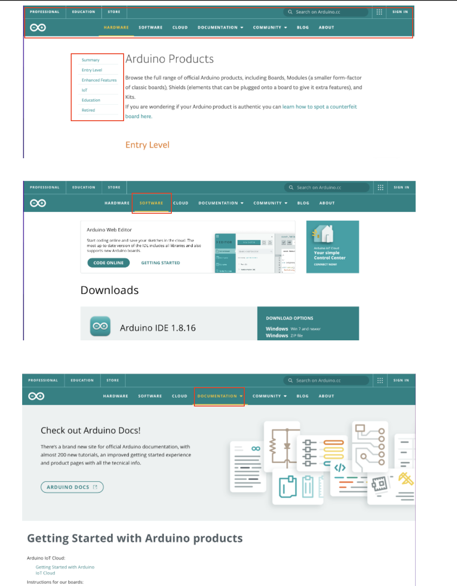

---

[⬅️ 返回網站架構觀念](../README.md)
