# 導覽列

> 每個觀念後面都有「🤖 用 AI 實作這個觀念」：把 Prompt 貼給 AI，讓它做出示範畫面，再對照觀念檢查。AI 很會「畫出」導覽列，但常常忘了標示目前位置、忘了手機版、忘了鍵盤操作，這些就要靠你看出來。

---

## 01 導覽列扮演的角色

### 達成目的的手段

導覽列是提供給使用者的一套 **操作體系**：它讓使用者了解頁面之間的位置關係與移動方式，而且操作方式前後一致。設計精良的導覽列能提醒使用者目前在哪個頁面，也讓使用者知道接下來還能去哪裡，進而感受到網站或應用程式的價值。

只要知道目前所在的頁面，就能理解這個頁面與其他頁面的關係。反之，如果使用者是從其他管道進入頁面，頁面與網站其他部分的關聯就可能斷掉，使用者也就很難理解頁面的內容。最典型的例子，就是從搜尋引擎直接進入網站深處的某一頁。導覽列不只說明目前所在位置，也幫助解釋頁面內容的意義，因此它和頁面標題一樣重要。

設計者很容易以為使用者會直線朝目標資訊前進，但事實並非如此。透過搜尋引擎進入深層頁面後，使用者可能經由分類頁前往其他頁面，也可能改用關鍵字搜尋或導覽列，行為模式非常多元。因此，導覽列必須設計得更有彈性，才能應付使用者難以預期的行為。

只要導覽列好用，所有操作都會變得流暢。**最理想的導覽列，是讓使用者忘記它的存在**——因為使用者是為了達成某個目的才來到網站，導覽列只是在一旁協助他們達成目的的手段。

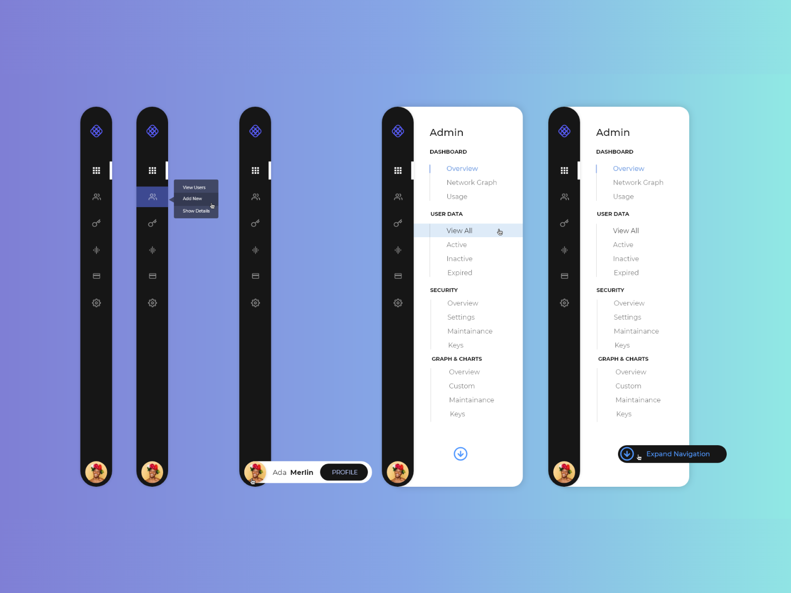

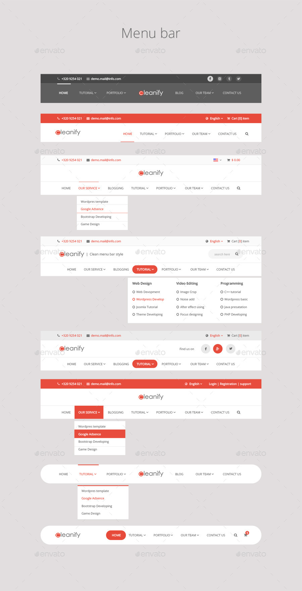

---

## 02 不同類型的導覽列區塊

### 負責引路的導覽列

導覽列不只是讓使用者在頁面之間移動的機制，也負責 **引路**。有時使用者需要知道自己到底在網站的哪裡，因此放置導覽列的區塊除了提供換頁功能，還必須依各自的角色 **固定在網頁的特定位置**，使用者才能掌握目前所在位置。

放置導覽列的區塊由 **「頁首」「全域導覽列」「麵包屑導覽」「區域導覽列」「關聯性導覽列」「頁尾」** 組成，「主要內容」則是該頁面的主要資訊。

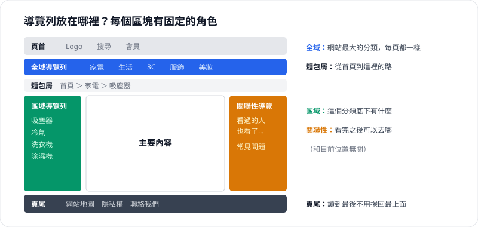


智慧型手機與平板電腦這類畫面有限的裝置（尤其是手機），能使用的導覽列區塊非常有限，不能隨意放太多個。導覽區塊應該採用上下堆疊而非左右並排，或改用可左右滑動的互動方式。總之，必須在導覽列的結構與編排上花更多心思。


### 🤖 用 AI 實作這個觀念

<details>
<summary>📋 Prompt：同一個網站的電腦版與手機版導覽</summary>

```text
請為一個線上書店設計首頁（單一 HTML 檔），包含頁首、全域導覽列、麵包屑、區域導覽列、主要內容、關聯性導覽列（推薦書單）與頁尾。
電腦版：全域導覽列在頁首下方，區域導覽列在左側。
手機版：全域導覽列改成底部固定的分頁列（首頁、分類、搜尋、購物車、會員，最多 5 個），
區域導覽列改成主要內容上方可以左右滑動的分類標籤。
請在每個導覽區塊的角落用小字標示它的名稱。
```

</details>

**看什麼：** 手機版的底部分頁列，目前所在的頁面有沒有被標示出來？項目是不是控制在 5 個以內？

---

## 03 常駐於畫面的「頁首與頁尾」

### 貫穿整個網站的共通區塊

**頁首與頁尾** 基本上會出現在每一個網頁，是讓所有頁面共享相同功能的共通元素。頁首通常放置 Logo、搜尋等與網站品牌相關的功能；頁尾則放置使用條款等規範性資訊，以及輔助的導覽連結。

近年來，頁首與頁尾變得越來越重要。畫面較窄的智慧型手機特別需要在這兩個區塊放置導覽；即使是其他裝置，也不能忽視頁首與頁尾作為導覽列的潛力，尤其是在使用 **「大型下拉式選單」（Mega Drop-down Menu）** 或 **「網站地圖式頁尾」** 的時候。


### 階層化的整體俯瞰圖

**大型下拉式選單**，是以「一整個區塊」展開的下拉選單，通常放在頁首或全域導覽列中。滑鼠移入或點擊時，會立刻展開一個大型選單；為了讓所有選項分組呈現，這種選單通常設計成不需要捲動，讓使用者一次看到所有選項。

**網站地圖式頁尾**，則是在頁尾放入簡易版網站地圖、份量十足的頁尾區塊。因為位於畫面最下方，即使範圍很大也不會干擾主要內容；使用者讀到頁面最後時，也不必再捲回最上方，就能直接前往其他頁面。

大型下拉式選單與網站地圖式頁尾的設計目的相同：**「讓使用者了解網站全貌，隨手一點就能前往目標頁面」**。這比另外製作一個網站地圖頁面更方便，也能讓使用者在不中斷思緒的情況下切換頁面。


### 🤖 用 AI 實作這個觀念

<details>
<summary>📋 Prompt：大型下拉式選單＋網站地圖式頁尾</summary>

```text
請為一所大學的官網設計首頁（單一 HTML 檔）：
1. 全域導覽列有「關於本校、學術單位、招生資訊、校園生活、研究」5 項。
   滑鼠移入或點擊時，展開大型下拉式選單：分成 3～4 欄，每欄有小標題與 4～6 個連結，不需要捲動。
   鍵盤也要能操作：Tab 移動、Enter 展開、Esc 關閉。
2. 頁尾是網站地圖式頁尾：列出 5 個大分類與底下的主要連結，再加上聯絡資訊與社群連結。
手機版：大型選單改成可以逐層展開的手風琴選單。
```

</details>

**看什麼：** 大型選單展開後會不會一移開滑鼠就馬上消失？（太敏感的選單很難用。）手機版有沒有正確改成手風琴？

---

## 04 代表位址與路徑的「麵包屑導覽」

### 具有輔助效果的文字資訊

**麵包屑導覽（Breadcrumb）** 代表網頁在網站中的 **位址與路徑**，也稱為「麵包屑列表」或「麵包屑導覽列」。所謂位址，是指該網頁相對於網站起點「首頁」的位置；路徑則是從首頁到達該網頁的脈絡。

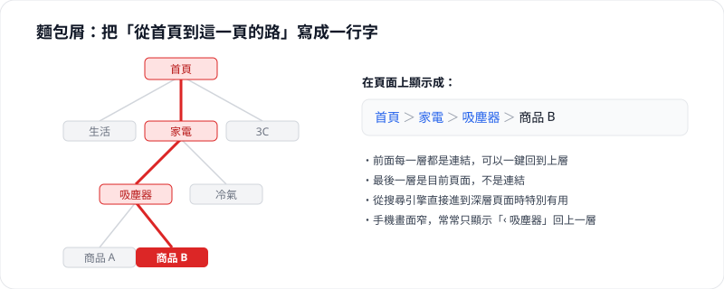

麵包屑導覽通常扮演輔助角色，與全域導覽列或區域導覽列搭配使用。它和區域導覽列的關係特別密切，因為兩者呈現的階層結構會有部分重疊；如果兩者不一致，反而會妨礙使用者掌握目前位置。因此，在協助使用者掌握位置（或路徑）之前，必須先決定 **以麵包屑導覽還是區域導覽列為主要依據**。


雖然麵包屑導覽通常只是輔助，但對於畫面太小、不方便放置全域或區域導覽列的裝置來說，它卻是非常重要的導覽工具；尤其在畫面很窄的智慧型手機上，麵包屑導覽更能發揮很大的作用。


### 🤖 用 AI 實作這個觀念

<details>
<summary>📋 Prompt：做一個正確的麵包屑</summary>

```text
請在一個電商網站的商品頁（單一 HTML 檔）加上麵包屑：首頁 ＞ 家電 ＞ 吸塵器 ＞ 無線吸塵器 V12。
要求：
1. 前面每一層都是連結，最後一層是目前頁面、不是連結。
2. 使用 <nav aria-label="麵包屑"> 與有序清單，目前頁面加上 aria-current="page"。
3. 加上 Schema.org 的 BreadcrumbList 結構化資料，讓搜尋引擎看得懂。
4. 手機版太長時，只顯示「‹ 吸塵器」回上一層。
```

</details>

**看什麼：** 最後一層是不是還能點？（不該能點。）手機版是不是只剩回上一層？

---

## 05 不同類型的「麵包屑導覽」

### 路徑不只一條時該怎麼辦？

麵包屑導覽代表的是「位址」或「路徑」，但如果到達某個頁面的路徑不只一條，該怎麼呈現呢？網站規模越大，越容易遇到這個問題，尤其是一個頁面有多個上層分類時更明顯。例如「藍牙耳機」這項商品，可以同時屬於「影音設備」「行動裝置」等分類，而且在不同情境下各有道理。

也就是說，一個頁面可以同時擁有多個上層頁面，因此麵包屑導覽的呈現方式可分成以下三種：

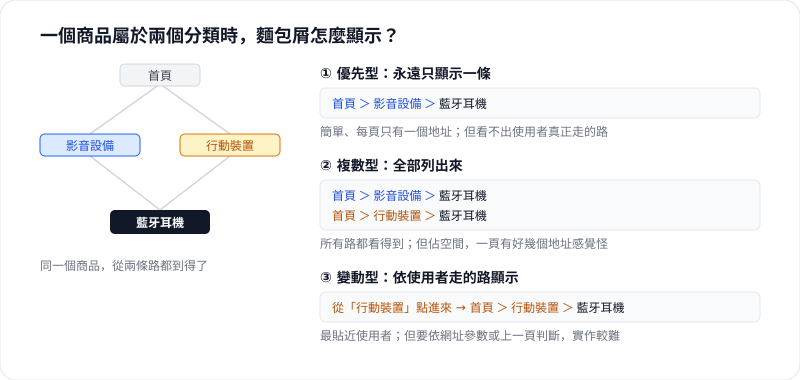

#### 優先型

固定顯示一條麵包屑導覽。不論從哪條路徑到達，頁面都只顯示同一條麵包屑，等於讓每個頁面只有一個位址；缺點是無法反映使用者實際走過的路徑。

#### 複數型

同時顯示多條麵包屑導覽。雖然能明確列出所有可能的路徑，卻看不出使用者是從哪一條來的；而且同一個頁面擁有多個位址，會讓人覺得奇怪，麵包屑也容易變得冗長。

#### 變動型

依照使用者實際走過的路徑切換麵包屑內容。可以參考上一頁的資訊，或依照網址中的參數來切換。由於是動態切換，實作難度也比較高。

### 🤖 用 AI 實作這個觀念

<details>
<summary>📋 Prompt：比較三種麵包屑</summary>

```text
請做一個小型原型（單一 HTML 檔＋少量 JavaScript）：
有兩個分類頁「影音設備」與「行動裝置」，兩頁都有「藍牙耳機」這個商品連結。
點進商品頁後，在頁面上同時展示三種麵包屑做比較：
1. 優先型：永遠顯示「首頁 ＞ 影音設備 ＞ 藍牙耳機」
2. 複數型：兩條都列出來
3. 變動型：依網址參數 ?from= 顯示使用者實際走過的那一條
每種下面註明優缺點。
```

</details>

**看什麼：** 分別從兩個分類點進去，變動型的麵包屑有沒有跟著改變？

---

## 06 「全域導覽列」與「區域導覽列」

### 代表結構與位置關係的主要導覽

**全域導覽列** 與 **區域導覽列** 代表了網站或應用程式的基本結構，也是所有導覽列中的主角。在兩者上標示目前所在位置，就能呈現目前頁面與整個網站的相對關係；它們同時也是使用者以一致的方式前往目標頁面的移動工具。

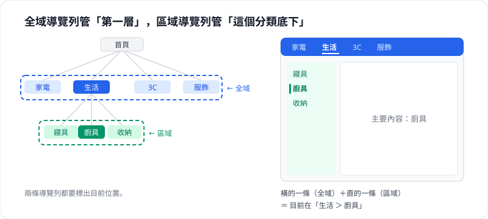

電腦版網站通常會在每個頁面同時放置全域導覽列與區域導覽列。為什麼「全域＋區域」兩段式的導覽會這麼普遍？原因有二：一是 **主要導覽列越多，雖然越便利，複雜度也越高**；二是 **畫面是平面的，垂直方向放一個、水平方向放一個，最容易規劃空間**。

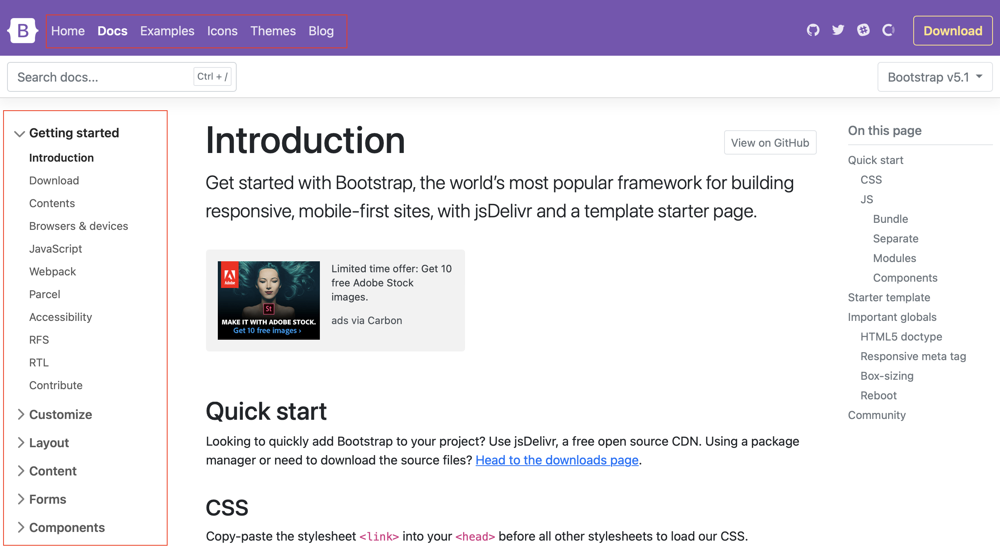

因此，雖然理論上與實務上都能在畫面中放三個以上的導覽列（例如「水平＋垂直＋水平」交錯排列，或三條水平導覽列層層堆疊），但一般來說，還是不會在同一個畫面中放置三個導覽列。

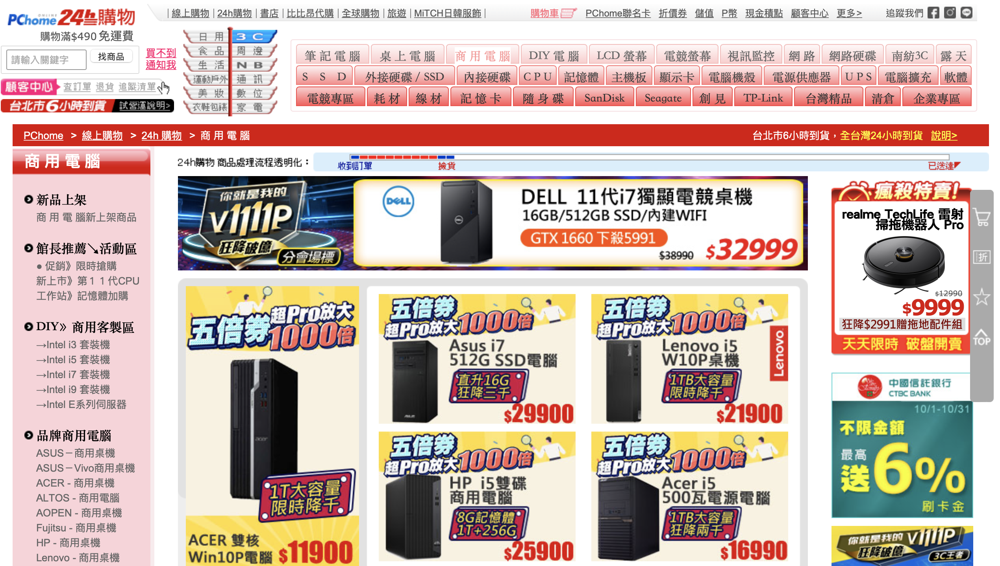

智慧型手機等畫面尺寸受限的裝置，有時很難同時放置全域與區域導覽列。尤其手機實際上只能在一個方向放置一個導覽列，因此通常只放全域導覽列，而無法另外放置區域導覽列。


### 🤖 用 AI 實作這個觀念

<details>
<summary>📋 Prompt：全域＋區域兩段式導覽</summary>

```text
請為一家連鎖健身房設計網站的「課程介紹 > 有氧課程」頁面（單一 HTML 檔）：
全域導覽列（水平，頁首下方）：關於我們、課程介紹、教練團隊、會員方案、分店據點。
區域導覽列（垂直，左側）：課程介紹底下的「重訓、有氧課程、瑜伽、飛輪、團體課」。
兩條導覽列都要標示目前位置（全域在「課程介紹」、區域在「有氧課程」），用不同的標示方式。
手機版只保留全域導覽列（收成漢堡選單），區域導覽列改成內容上方的分類標籤。
```

</details>

**看什麼：** 兩條導覽列有沒有「都」標示目前位置？只標一條，使用者就只知道一半。

---

## 07 讓使用者從他處回流的「關聯性導覽列」

### 跳到其他相關頁面

**關聯性導覽列** 與網站結構、目前所在位置都沒有直接關係，而是在使用者看完頁面內容後，引導他前往其他相關頁面。具體來說，像是「這個商品分類的常見問題請點此」這類相關資訊連結，或是「瀏覽此頁的人也看了這些頁面」這類推薦功能。

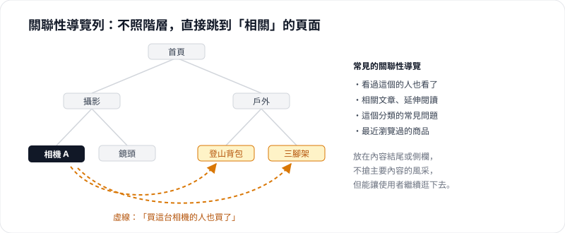

關聯性導覽列不包含任何表示位置關係的元素，只是承接主要內容、提供前往其他頁面的入口，因此通常放在畫面右側、內容結尾或區域導覽列下方等不太顯眼的位置。此外，關聯性導覽列也常混入橫幅、廣告、篩選功能等繁雜的資訊，本來就不希望太引人注意。

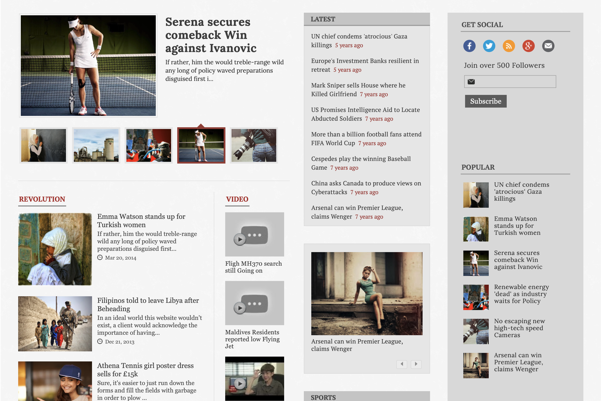

話雖如此，關聯性導覽列的用法與設計，仍可能影響整個網站的方向，絕對不能忽視。例如 Amazon 的關聯性導覽列，就提供了讓使用者覺得很有價值的連結與資訊。


### 🤖 用 AI 實作這個觀念

<details>
<summary>📋 Prompt：商品頁的關聯性導覽</summary>

```text
請設計一個登山用品網站的「登山背包」商品頁（單一 HTML 檔），在主要內容之後加上三種關聯性導覽：
1. 「經常一起購買」：背包＋登山杖＋水袋的組合，顯示合計價格與一鍵加入購物車
2. 「看過這個商品的人也看了」：4 個商品，可以左右滑動
3. 「這個分類的常見問題」：3 個問題連結
這些區塊的視覺份量要比主要內容輕，不要搶走「加入購物車」按鈕的注意力。
```

</details>

**看什麼：** 關聯性導覽有沒有比主要按鈕更搶眼？如果有，就喧賓奪主了。

---

## 08 垂直型與水平型的「區域導覽列」

### 各有特色的兩種類型


區域導覽列可分成 **「垂直型」** 與 **「水平型」** 兩種，各有優缺點。

**垂直型** 通常出現在雙欄式或三欄式版面中，位於主要內容的左側或右側。區域導覽列的一大功能，是讓使用者透過階層結構了解目前所在位置，而垂直型在這方面表現較好；選項較多時，垂直排列也能容納更多項目。缺點是會佔據畫面左側或右側的整條空間，等於壓縮了主要內容的寬度。


**水平型** 只顯示同一階層的選項，一眼就能看到所有選項，設計精巧，也不會壓縮主要內容的空間。缺點是可用寬度會隨裝置的畫面大小改變，能放的選項非常有限；而且只能顯示同一階層，使用者很難看出網站的整體結構。


因此，該選用哪一種，要看網站的階層深度、分類數量，以及主要內容需要多少空間而定。如果網站階層很深、資訊量又非常龐大，也可以同時使用水平型與垂直型的區域導覽列。

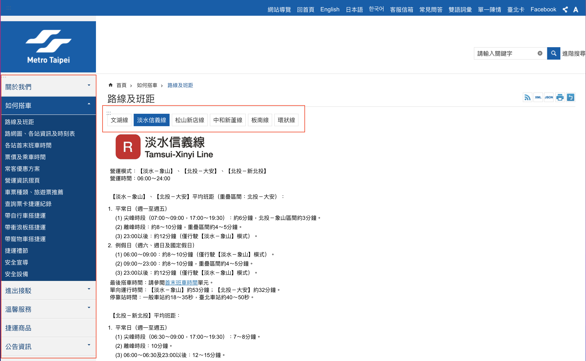

---

## 09 透過「區域導覽列」顯示的階層

### 只顯示下層，還是同層＋下層？

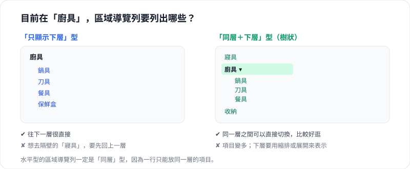

當導覽結構是階層式時，區域導覽列的顯示方式大致可分成兩種：

- **「只顯示下層」型**：只列出目前所在位置的下一層項目
- **「同層＋下層」型**：列出目前所在位置的同一層項目，以及下一層項目

**「只顯示下層」型** 能透過階層說明連結之間的相對位置，也能透過區域導覽列「往下一層」移動。但因為無法在同一層之間移動，使用者必須先回到上一層，才能再進入其他的下層頁面。


**「同層＋下層」型** 除了顯示階層的相對位置，也能透過區域導覽列在 **同一層之間** 移動，因此使用者更容易在相關頁面之間來回瀏覽（回流性較高）。相對地，就得在「往下一層移動」這點上多花心思：可以在同層連結底下加上下層連結，或利用主要內容區塊中的連結往下一層移動（水平型區域導覽列在結構上必須採用同層顯示）。這是便利性高、但較缺乏變化的結構。


### 🤖 用 AI 實作這個觀念（第 08、09 節）

<details>
<summary>📋 Prompt：比較區域導覽列的四種組合</summary>

```text
請做一個比較頁（單一 HTML 檔），用同一個「生活用品 > 廚具」頁面，展示四種區域導覽列：
1. 垂直型＋只顯示下層（鍋具、刀具、餐具、保鮮盒）
2. 垂直型＋同層＋下層（寢具、廚具▾〔鍋具、刀具、餐具〕、收納，目前在廚具）
3. 水平型（寢具、廚具、收納，放在內容上方）
4. 水平型＋垂直型同時使用
每一種下面寫出：使用者想去「寢具」要點幾下？想去「刀具」要點幾下？
```

</details>

**看什麼：** 比較每一種「去隔壁」和「往下一層」各要點幾下，就知道為什麼「同層＋下層」比較好逛。

---

## 10 「樹狀型區域導覽列」的位置

### 放左邊還是右邊？

區域導覽列放在網站左側是目前的主流，不過曾有一段時間流行放在右側。當時的理由包括：主要內容放在左側比較容易被看到；主要內容的右側被截斷不好看；能提升 SEO（Search Engine Optimization，搜尋引擎最佳化）的效果；或是單純覺得這樣比較與眾不同。

隨著搜尋引擎進步、各家瀏覽器都能正確顯示 CSS 版面，右側導覽列已不再具有 SEO 上的優勢。儘管其他優點仍在，右側導覽列已不像過去那麼常見。原因之一是：右側導覽列在展開階層結構時看起來不太自然，樹狀型的區域導覽列尤其明顯。

### 順著文字的閱讀方向配置

無論中文、英文還是日文，網頁上的文字大多是由左至右閱讀，因此表示階層的「縮排」也應該放在文字左側；區域導覽列的階層結構，自然也應該是由上而下、由左至右展開。如果把區域導覽列放在右側，視線移到畫面最右邊後，又得大幅移回左側才能繼續閱讀主要內容，這種視線流動並不自然，會讓閱讀變得吃力。

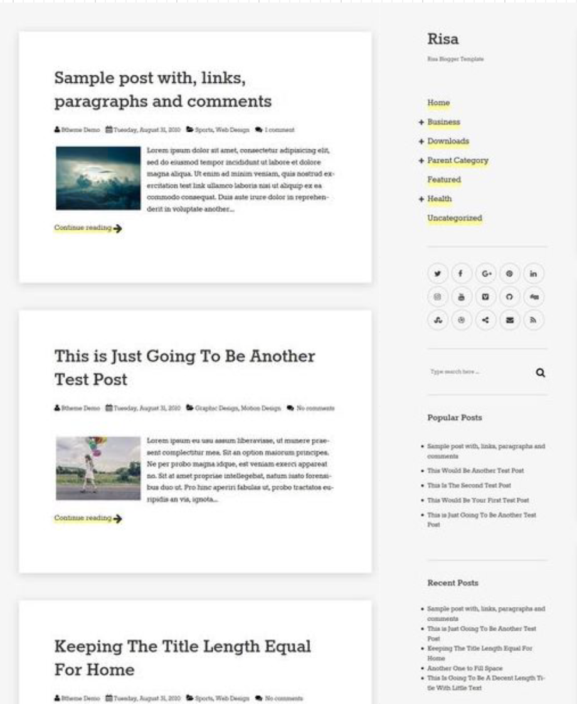

**區域導覽列的角色，是說明網站內部的階層結構與目前所在位置**，因此讓使用者在閱讀內容之前先看到它，才是自然的順序。換句話說，樹狀型的區域導覽列應該放在主要內容的左側，才能營造自然的印象，並有效發揮應有的作用。


---

## 11 「主要內容區塊」的位置

### 把優先順序高的內容放在左側

當區域導覽列或各種篩選功能必須和主要內容左右並排時，主要內容應該放在左側還是右側比較好？

先說結論：**優先順序較高的內容，基本上應該放在畫面左側**。理由不只是因為視線由左側開始移動，也因為畫面較窄時，右側內容可能被畫面邊界截斷。所以，主要內容、區域導覽列或關聯性導覽列該放在哪一側，要看這個頁面以哪一個為重。

新聞類網站以主要內容為重心，其他內容都是配角，因此主要內容放在左側比較適當。


反之，如果是需要讓使用者掌握目前所在位置的網站，區域導覽列就應該放在左側、主要內容放在右側；例如區域導覽列是樹狀結構時，就必須這樣安排。這不代表主要內容不重要，而是更重視「掌握所在位置」，並希望透過區域導覽列讓使用者在網站中回流。

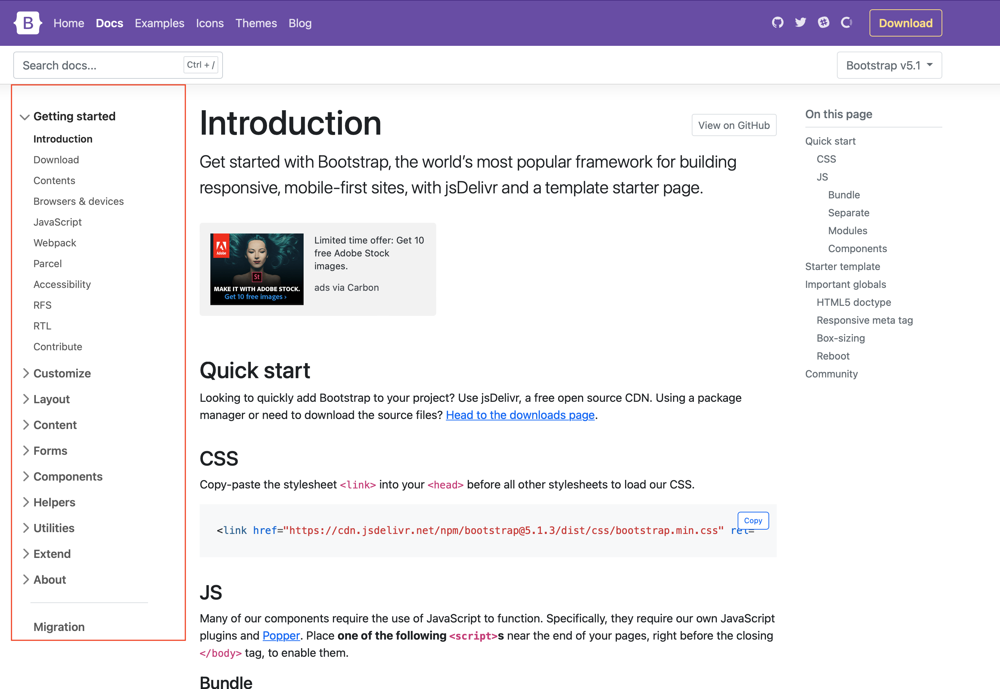

此外，如果頁面需要各種條件篩選功能，而這些篩選又會影響主要內容的呈現，通常把篩選功能放在畫面左側（或內容區塊上方）會比較適當，如此才能設計出清楚陳列所有搜尋結果的版面。

### 🤖 用 AI 實作這個觀念（第 10、11 節）

<details>
<summary>📋 Prompt：左邊還是右邊？</summary>

```text
請做兩個版本的頁面並排比較（單一 HTML 檔，可切換）：
A. 新聞網站文章頁：主要內容在左、熱門新聞在右
B. 線上說明文件頁：樹狀目錄在左、內容在右
再各做一個「左右顛倒」的版本。
最後請用一段話說明：為什麼新聞網站主要內容放左邊，而說明文件卻把目錄放左邊？
```

</details>

**看什麼：** 看 AI 的解釋有沒有說到「這一頁最重要的是什麼」。這就是決定左右的關鍵。

---

## 12 讓導覽列的位置與內容固定

### 固定位置

相信大家都有過在網站上越逛越迷路，最後乾脆關掉瀏覽器的經驗吧。使用者迷路的原因很多，其中之一就是 **導覽列的位置與內容在沒有理由的情況下改變**。

全域導覽列、區域導覽列、麵包屑導覽這些帶有位置資訊的導覽列，除非有明確的理由，否則在整個網站中的位置都應該固定不變。這樣才能清楚區分主要內容與導覽區塊，也讓使用者在瀏覽過程中逐漸熟悉導覽列的位置。

如果導覽列的位置或內容改變，單看一個頁面可能察覺不到；但使用者一換頁，就會因為導覽列跑到別的地方而覺得不對勁，徒增瀏覽的困難。

### 固定起點

除了位置之外，導覽列的內容，也就是資訊的 **起點**（從哪一層開始列出），也最好固定不變。使用者換頁時，是透過畫面中「有變化的元素」來理解頁面的相對位置與移動方向；導覽列的內容固定，也能讓使用者在不知不覺中熟悉資訊的起點。

幾乎所有網站的 **全域導覽列與麵包屑導覽，起點都是固定的**；但常見的問題是，區域導覽列的起點在每個頁面都不一樣，導致使用者無法理解自己的位置。

不過，在下列情況中，區域導覽列的位置與內容 **不固定** 反而是較好的選擇：

- 「商品資訊」等 **內容本身比位置資訊更重要** 的頁面
- 「搜尋結果」等 **區域導覽列被當作篩選功能**、而非導覽列使用的頁面
- 「會員註冊」「聯絡我們」等 **功能大幅轉換** 的頁面


### 🤖 用 AI 實作這個觀念

AI 一頁一頁做網站時，最常犯的錯就是「每一頁的導覽列長得不一樣」。用這個練習檢查：

<details>
<summary>📋 Prompt：多頁網站的導覽一致性檢查</summary>

```text
請為一間社區診所做 4 個頁面（4 個 HTML 檔，彼此可以點擊切換）：首頁、門診時間、醫師介紹、線上掛號。
1. 前三頁的頁首、全域導覽列、頁尾必須完全相同，只有目前位置的標示不同。
2. 「線上掛號」是功能轉換的頁面：改成簡化的頁首（只有 Logo 與「返回首頁」）和步驟條，讓使用者專心填表。
3. 把共用的導覽列寫成一份，四頁一起使用，不要每頁各寫一份。
完成後，請列出四頁導覽列的差異，確認只有應該不同的地方不同。
```

</details>

**看什麼：** 在四頁之間快速切換，導覽列有沒有「跳動」或位置偏移？線上掛號頁的導覽列改變，是不是有明確的理由？

---

[⬅️ 返回網站架構觀念](../README.md)
