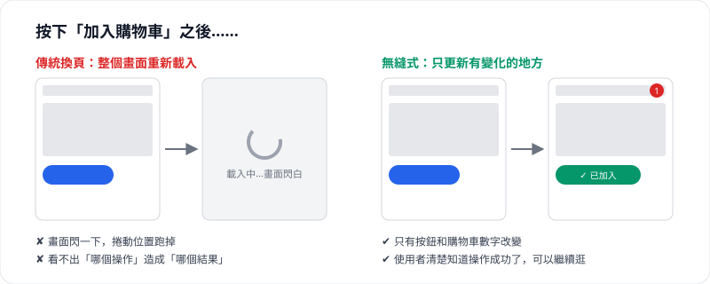
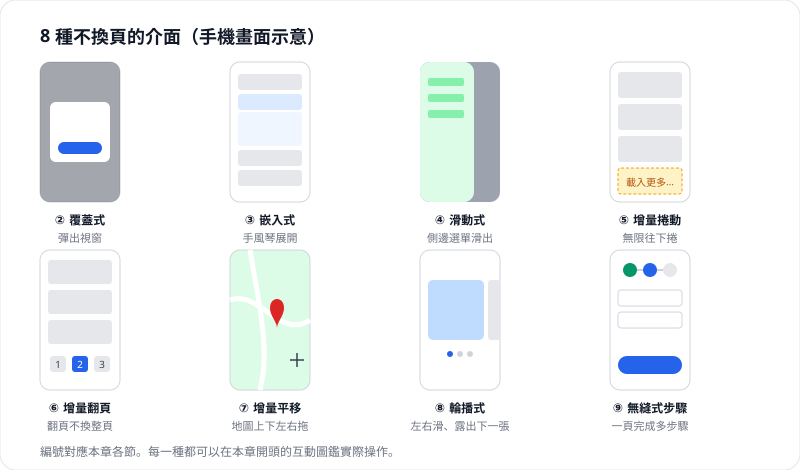
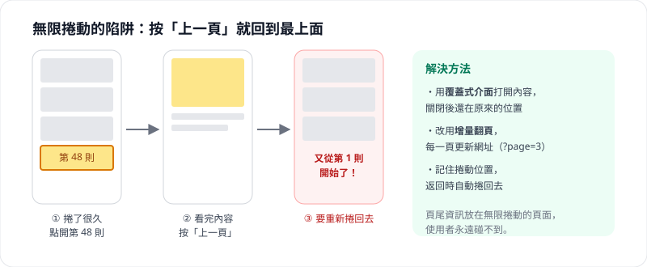

# 無縫式介面

> 每個觀念後面都有「🤖 用 AI 實作這個觀念」：把 Prompt 貼給 AI 做出可以操作的原型，再和互動圖鑑的 demo 比較。

> [!TIP]
> **🎮 互動圖鑑**：本章 9 種介面都有可以直接操作的 demo，邊讀邊玩更容易理解 👉 **[無縫式介面圖鑑](https://roberthsu2003.github.io/UI_UX_Prototype/seamless.html)**
>
> 每個 demo 上方都有切換按鈕（例如「傳統換頁 vs 無縫」「一次只開一個 vs 可同時展開」），請實際操作並比較差異。

## 01 什麼是不切換畫面的介面？

> 🎮 **互動 demo**：[全頁更新 vs 局部更新 對照](https://roberthsu2003.github.io/UI_UX_Prototype/seamless.html#compare)

### 更自然、更直覺的操作




所謂 **「無縫式介面」（Seamless Interface）**，是指畫面不需要切換、操作過程也不會被中斷，在 **單一畫面** 中就能完整呈現的介面。在不換頁的前提下把功能容納在同一個畫面裡，使用者比較容易理解操作方式，也比較不會覺得介面龐雜。

為什麼單一畫面的介面比較容易理解？因為 **只更新受影響的局部**，比整個畫面重新載入更自然，使用者也更清楚「哪個操作得到了哪個回應」。

### 拜技術進步之賜

網頁原本基本上是 **靜態** 的：大部分內容在顯示一次之後，就一直維持相同的狀態。不切換畫面的介面之所以能普及，要歸功於裝置效能的提升、JavaScript 等前端技術的演進、各家瀏覽器相容性的改善，以及在背景負責傳輸資料與更新畫面的 **Ajax** 技術。

其實早在 Google Suggest（搜尋建議）這類 Ajax 服務出現之前，無縫式介面在理論上就已經做得到，只是受限於效能與相容性，遲遲無法實際應用。如今，這種不切換畫面的介面已從電腦普及到智慧型手機，而且隨著裝置與技術的進步，介面設計還有更多可能性。


### 本章介紹的 8 種介面



### 🤖 用 AI 實作這個觀念

<details>
<summary>📋 Prompt：全頁更新 vs. 局部更新</summary>

```text
請做一個比較頁（單一 HTML 檔），左右並排兩個一樣的商品卡片：
左邊：按「加入購物車」時模擬傳統換頁（整個區塊閃白、顯示載入中 1 秒後重新出現）
右邊：按「加入購物車」時只有按鈕變成「✓ 已加入」、右上角購物車數字加 1
讓我比較兩種做法的感受。
```

</details>

**看什麼：** 哪一邊讓你更清楚「我的操作成功了」？

---

## 02 覆蓋式介面

> 🎮 **互動 demo**：[中央彈窗 / 底部抽屜](https://roberthsu2003.github.io/UI_UX_Prototype/seamless.html#overlay)

### 用途廣泛的簡易彈出介面

所謂 **「覆蓋式介面」（Overlay）**，是指不重新載入畫面，直接在目前的畫面上顯示一個 **彈出式介面（Pop-up）**。它可以用 JavaScript 等前端技術製作，內容可以在背景即時載入，也可以直接寫在 HTML 中。由於檔案量很小，從電腦到智慧型手機，各種裝置都能使用。

當你不想切換畫面、希望保留目前的操作狀態時，就適合使用覆蓋式介面。它能避免換頁造成的瀏覽中斷，也適用於「想暫停目前的操作，但之後要回來繼續」的情況。在重要或獨立的連續流程中，用覆蓋式介面顯示是最有效的做法；想讓畫面在視覺或結構上更簡潔時，覆蓋式介面也能派上用場，可說是用途多元又實用的介面。


### 🤖 用 AI 實作這個觀念

<details>
<summary>📋 Prompt：無障礙的彈出視窗</summary>

```text
請做一個活動報名頁（單一 HTML 檔），點「我要報名」時打開覆蓋式的報名表單：
電腦版是畫面中央的彈出視窗，手機版改成從底部滑上來的抽屜。
要求：背景變暗且不能捲動；按「✕」、按 Esc、點背景都能關閉；
打開時焦點移到表單第一個欄位，關閉後焦點回到「我要報名」按鈕。
請使用 HTML 的 <dialog> 元素。
```

</details>

**看什麼：** 關閉彈窗後，焦點有沒有回到原本的按鈕？用鍵盤 Tab 試試看，焦點會不會跑到背景的頁面去？

---

## 03 嵌入式介面

> 🎮 **互動 demo**：[FAQ 手風琴](https://roberthsu2003.github.io/UI_UX_Prototype/seamless.html#accordion)

### 節省空間的折疊功能

讓原本隱藏的資訊直接在頁面中展開、佔據局部空間的，就是 **「嵌入式介面」（Inlay）**。因為它能像手風琴的風箱一樣折疊，所以又稱為 **「手風琴式介面」（Accordion）**。

想保留原本的畫面、又想顯示更多資訊，或是想一次列出大量項目時，不妨考慮嵌入式介面。它是往上下方向展開的，所以也很適合螢幕寬度有限的智慧型手機。此外，展開的內容不一定要關起來，展開狀態下捲動畫面或前往其他頁面都不會有問題，能讓頁面操作變得輕快許多。

嵌入式介面有兩種做法：**可同時展開多個項目**，或 **一次只能展開一個項目**。前者雖然可能讓頁面變得凌亂，但適合用來呈現簡短或少量的資訊；後者因為一次只展開一項，頁面不會顯得雜亂。


### 🤖 用 AI 實作這個觀念

<details>
<summary>📋 Prompt：兩種手風琴並排比較</summary>

```text
請做一個常見問題（FAQ）頁（單一 HTML 檔），並排兩個版本的手風琴：
A. 可以同時展開多個問題
B. 一次只能展開一個，打開新的會自動關閉舊的
每個版本 6 題。展開時有箭頭旋轉的動畫，按鈕要有 aria-expanded 屬性，鍵盤 Enter 與空白鍵都能展開。
```

</details>

**看什麼：** 實際操作兩個版本：問題很短時哪一個好用？答案很長時呢？

---

## 04 滑動式介面

> 🎮 **互動 demo**：[手機側邊選單：覆蓋 / 推開](https://roberthsu2003.github.io/UI_UX_Prototype/seamless.html#slide)

### 從螢幕左右展開的選單區塊

**「滑動式介面」（Slide）** 是從螢幕左側或右側展開的介面，主要有兩種顯示方式：一種是讓原本隱藏的區塊 **覆蓋** 在畫面上；另一種是把原本的畫面 **推開**，讓新區塊從側邊滑入。使用滑動式介面，可以做出「虛擬」的雙欄式或三欄式版型，在螢幕較小的智慧型手機或平板電腦上特別好用。

滑動式介面常被當作全域導覽列或區域導覽列使用，理由有二：一是版面空間不足，無法另外放置選單；二是不希望選單一直佔據畫面。前者多半是手機的限制，後者則是依服務的設計與功能優先順序所做的取捨。

滑動式介面放在左側或右側都可以，兩側同時都有也沒問題；但如果只能選一邊，通常會選 **左側**，原因和區域導覽列習慣放在左側相同（參考 [導覽列：「樹狀型區域導覽列」的位置](../導覽列/README.md)）。


### 🤖 用 AI 實作這個觀念

<details>
<summary>📋 Prompt：覆蓋 vs. 推開</summary>

```text
請做一個手機版部落格首頁原型（單一 HTML 檔），左上角選單按鈕打開側邊選單，
並提供切換按鈕比較兩種方式：
A. 覆蓋：選單蓋在頁面上，背景變暗
B. 推開：整個頁面往右推，選單從左側出現
兩種都要能用手指往左滑關閉選單。
```

</details>

**看什麼：** 哪一種讓你比較清楚「選單只是暫時出現、關掉就回到原本的頁面」？

---

## 05 增量捲動介面

> 🎮 **互動 demo**：[評論牆無限捲動與「上一頁」問題](https://roberthsu2003.github.io/UI_UX_Prototype/seamless.html#infinite-scroll)

### 不分段、連續顯示內容

所謂 **「增量捲動介面」（Incremental Scroll）**，是可以不斷往下捲動、持續載入內容的介面，也就是常說的「無限捲動」。捲到內容底部時，會自動載入下一批內容，或是透過「載入更多」按鈕手動載入。這種介面適合整理大量內容，常用在搜尋結果或各種列表。由於新內容是在背景透過網路取得，離線時無法正常瀏覽。

### 與「上一頁」按鈕的衝突




增量捲動介面最不方便的地方，在於 **很難搭配「上一頁」按鈕使用**。使用者捲動了一段距離、點進某個項目後再按「上一頁」，通常會回到尚未捲動的初始畫面；如果剛才點的項目原本在很下面，就得重新捲回相同的位置。

這和網址（URL）的控制方式有關：一般來說，增量捲動不會隨著捲動更新網址，所以單靠技術很難完全解決。比較實際的做法，是 **用新視窗或覆蓋式介面開啟項目內容**，讓使用者關閉後直接回到原本的位置。


### 🤖 用 AI 實作這個觀念

<details>
<summary>📋 Prompt：會記住位置的無限捲動</summary>

```text
請做一個餐廳評論牆（單一 HTML 檔，用假資料），捲到底部自動載入下一批 10 則評論。
點任何一則評論時，用覆蓋式介面打開詳細內容（不換頁），關閉後要停在原本的位置。
另外：頁尾的聯絡資訊放在固定的側欄，或改用「載入更多」按鈕，不要讓使用者永遠捲不到頁尾。
```

</details>

**看什麼：** 捲到很下面、點開一則評論、關閉，是不是還停在原處？頁尾的資訊碰得到嗎？

---

## 06 增量翻頁介面

> 🎮 **互動 demo**：[無縫分頁與網址同步](https://roberthsu2003.github.io/UI_UX_Prototype/seamless.html#paging)

### 不切換畫面的翻頁瀏覽

**「增量翻頁介面」（Incremental Paging）** 是以「翻頁」方式持續顯示內容的介面。和一般分頁不同的是，它 **不會切換整個頁面**，所以使用者會覺得自己一直停留在同一個頁面或功能裡。

增量翻頁與增量捲動的本質相同：瀏覽方向都朝同一個方向延伸，移動多少就載入多少新內容。最大的差別在於，增量翻頁不是連續顯示，而是 **每到一個段落就切換內容**，例如每一頁、每一項商品或每 20 項商品為一段，看完一段就換下一段。

在「上一頁」按鈕的問題上，增量翻頁和增量捲動面臨的狀況一樣。不過翻頁時可以 **同步更新網址**，所以實務上增量翻頁是可以支援「上一頁」的。就像瀏覽器版的 Gmail 一樣，只要妥善控制網址，就能做出支援「上一頁」按鈕的應用程式。


### 🤖 用 AI 實作這個觀念

<details>
<summary>📋 Prompt：翻頁時同步更新網址</summary>

```text
請做一個商品列表（單一 HTML 檔，用假資料 60 個商品），每頁 12 個，用下方的頁碼切換，不重新載入整頁。
切換頁碼時用 history.pushState 把網址改成 ?page=2，
按瀏覽器的「上一頁」能回到前一頁的商品，直接打開 ?page=3 的網址也能看到第 3 頁。
```

</details>

**看什麼：** 按瀏覽器的「上一頁」試試，有沒有回到前一頁的商品，而不是離開網站？

---

## 07 增量平移介面

> 🎮 **互動 demo**：[可拖曳的門市地圖](https://roberthsu2003.github.io/UI_UX_Prototype/seamless.html#panning)

### 在畫面中上下左右移動

**「增量平移介面」（Incremental Panning）** 是可以把畫面上下左右拖曳的介面。因為能在螢幕中自由移動，常用在資料往四面八方延伸的地圖服務，Google Maps 就是最具代表性的例子。它同樣是在背景透過網路取得資料，因此無法離線使用。

增量平移介面不只能全螢幕顯示，也能只在頁面的局部區域使用，所以常作為輔助用途，例如在頁面中嵌入一張小地圖。它和縮放功能也非常契合，除了地圖之外，稍加變化就能做出既實用又有魅力的介面。


### 🤖 用 AI 實作這個觀念

<details>
<summary>📋 Prompt：可以拖曳的門市地圖</summary>

```text
請做一個連鎖咖啡店的「門市查詢」頁（單一 HTML 檔，使用 Leaflet 與 OpenStreetMap），
地圖上標示台北 8 間門市，可以拖曳、縮放。
點地圖上的標記，右側（手機版是下方）的門市清單會捲到並標示那一間；點清單裡的門市，地圖也會移到那一間。
```

</details>

**看什麼：** 地圖與清單是不是「互相連動」？只做一邊就少了一半的用處。

---

## 08 輪播式介面

> 🎮 **互動 demo**：[商品輪播與滑動提示](https://roberthsu2003.github.io/UI_UX_Prototype/seamless.html#carousel)

### 節省空間的水平捲動

所謂 **「輪播式介面」（Carousel）**，是以水平捲動或翻頁方式、搭配視覺效果呈現內容的介面，白話來說就像「旋轉木馬」。有些輪播會在捲到最後一項時回到第一項，有些則直接告訴使用者已經到底了。基本上，輪播式介面是 **內容數量有限** 的水平捲動介面，不會無止盡地載入內容。

由於輪播是水平捲動，特別適合呈現圖片等視覺內容，而不適合文字；文字比較適合垂直捲動閱讀。為了讓使用者知道這個區塊可以左右滑動，通常會 **讓最邊緣的圖片露出一半**、在下方放置 **圓點指示器**，或在左右兩側加上 **箭頭**，用視覺設計提示使用者。

輪播式介面的優點是不受畫面大小限制、編排自由度高、非常節省頁面空間，同一頁放好幾組輪播也不會破壞頁面結構。對螢幕有限、習慣垂直瀏覽的智慧型手機來說，特別適合使用。

> [!WARNING]
> 輪播中第二張以後的內容，**很多使用者根本不會看到**。重要資訊不要只放在輪播裡（參考 [設計的講究之處：利用精簡的手法創造更豐富的內容](../設計的講究之處/README.md)）。


### 🤖 用 AI 實作這個觀念

<details>
<summary>📋 Prompt：有提示的商品輪播</summary>

```text
請做一個「本週推薦」商品輪播（單一 HTML 檔），8 個商品卡片：
1. 右邊露出下一張卡片的一部分，提示可以滑動
2. 下方有圓點指示目前位置，左右有箭頭按鈕
3. 手機可以用手指滑動，電腦可以用鍵盤左右鍵
4. 不要自動播放（或提供暫停按鈕）
最後在輪播下方用文字列出第 1 名商品，因為很多人不會滑到後面。
```

</details>

**看什麼：** 只看第一眼（不滑動），你知道這裡可以左右滑嗎？

---

## 09 無縫式步驟

> 🎮 **互動 demo**：[包場預約三步驟](https://roberthsu2003.github.io/UI_UX_Prototype/seamless.html#steps)

### 輕快的連續流程

所謂 **「無縫式步驟」（Seamless Step）**，是指會員註冊、購買商品這類多步驟流程，在 **不切換畫面** 的前提下，於單一畫面中完成所有步驟。為了在同一個畫面完成整個流程，通常需要在背景取得資料，並把各步驟的內容收納在覆蓋式介面中。

傳統做法是每個步驟換一個頁面，這在功能上完全沒有問題。之所以刻意多花心力做成無縫式步驟，是為了 **減少使用者的不耐煩**：讓使用者覺得流程迅速、簡單、連貫，感覺「一個頁面就完成了」，操作經驗更愉快，也比較不會中途放棄。

把多個步驟放在同一個頁面，目的並不是為了節省頁面空間，而是為了提供 **更好的使用體驗**，讓使用者覺得整個流程是在幫助自己。


### 🤖 用 AI 實作這個觀念

<details>
<summary>📋 Prompt：一頁完成三步驟預約</summary>

```text
請做一個包場預約流程（單一 HTML 檔），三個步驟在同一個畫面完成、不換頁：
1. 選日期與時段　2. 填人數與聯絡資料　3. 確認並送出
上方有步驟條顯示目前在第幾步；每一步都可以「上一步」回去修改，已填的資料不會消失；
欄位有即時驗證；送出後在同一個畫面顯示預約成功與預約編號。
```

</details>

**看什麼：** 回到上一步時，剛剛填的資料還在嗎？使用者最討厭的就是重填。

---

[⬅️ 返回網站架構觀念](../README.md)
