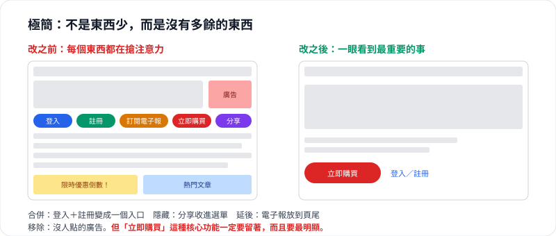
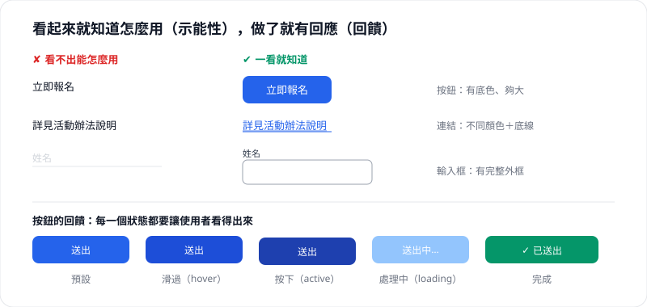
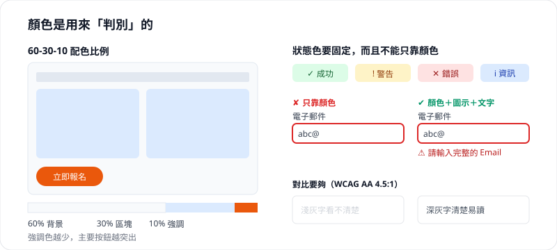
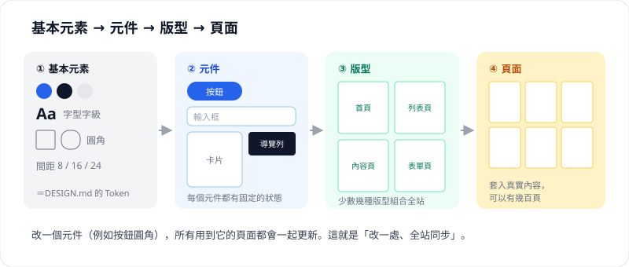
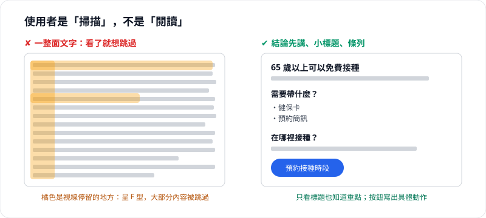
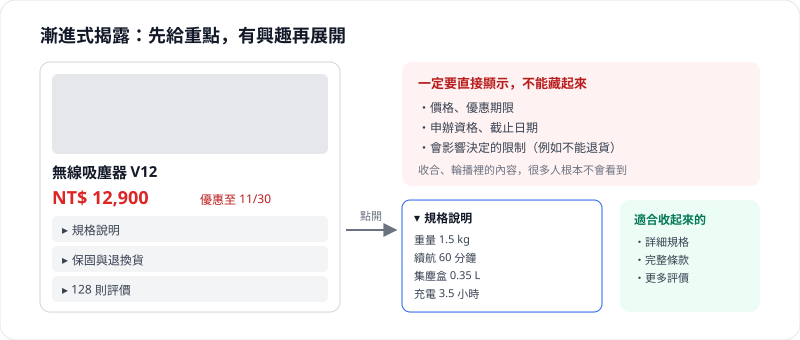

# 設計的講究之處

前面幾章談的是網站的「骨架」：立體構造、版型、導覽列、一致性與無縫式介面。本章談的是「肌肉與皮膚」——同樣的骨架，為什麼有的網站用起來就是順手、看起來就是舒服？差別往往藏在這些細節的講究裡。

> [!TIP]
> 本章每一節最後都有兩種 Prompt：**🤖 用 AI 實作**（請 AI 做出示範，親眼看到觀念）與 **🤖 用 AI 檢查**（拿來檢查自己的原型或既有網站）。檢查結果可以寫進 [`DESIGN.md`](../../建立自己的DESIGN_md/README.md) 的 Do's and Don'ts 章節。

---

## 01 讓介面變得極簡

### 極簡不是「東西少」，而是「沒有多餘的東西」



極簡（Minimal）常被誤解成「留很多白、放很少字」。真正的極簡是：**畫面上每一個元素都有存在的理由，拿掉任何一個都會讓使用者更難完成任務**。

判斷一個元素該不該留下，可以問三個問題：

1. **它幫助使用者完成哪一個任務？** 答不出來就是裝飾。
2. **如果拿掉它，使用者會發現嗎？** 不會發現，就可以拿掉。
3. **它是否和其他元素在說同一件事？** 重複的訊息只留一個。

### 常見的「減法」手法

| 手法 | 說明 | 範例 |
| :--- | :--- | :--- |
| **合併** | 把功能相近的按鈕或連結合併 | 「登入」「註冊」合併成一個入口，進入後再分流 |
| **隱藏** | 低頻功能收進選單或「更多」 | 進階搜尋條件預設收合 |
| **延後** | 等到需要時才出現 | 表單填完必填欄位後才顯示「選填資訊」 |
| **移除** | 沒有人用的功能直接拿掉 | 用數據確認點擊率趨近於零的側欄廣告區 |

> [!WARNING]
> **極簡的代價**：隱藏得太深，使用者會找不到。高頻核心功能（例如電商的「加入購物車」、政府網站的「線上申辦」）**絕對不能為了畫面乾淨而藏起來**。這就是 [如何評估現有的網站](../../如何評估現有的網站/README.md) 提到的「權衡與妥協（Trade-offs）」。

### 🤖 用 AI 實作這個觀念

<details>
<summary>📋 Prompt：一般版與極簡版並排</summary>

```text
請為一間社區瑜伽教室設計首頁的首屏（單一 HTML 檔），並排兩個版本：
A. 一般版：導覽列有 8 個項目、主視覺上有 4 顆不同顏色的按鈕、右側有公告欄與社群連結。
B. 極簡版：用「合併、隱藏、延後、移除」整理 A 版，最後只留下一個最重要的行動按鈕。
在 B 版下方列出：每一個被拿掉或移動的元素，用了哪一種手法、為什麼。
```

</details>

**看什麼：** B 版的主要按鈕是不是「預約體驗課」這種核心功能？如果 AI 把核心功能也藏起來了，就是極簡過頭。

**🤖 用 AI 檢查（拿來檢查自己的原型或既有網站）**
```text
請以「極簡設計」的角度檢查這個頁面（附截圖）：
1. 列出畫面上所有元素，並標註每個元素對應的使用者任務；找不到任務的標為「裝飾」。
2. 找出訊息重複的元素。
3. 依「合併／隱藏／延後／移除」四種手法提出精簡建議，
   但請同時指出哪些是高頻核心功能、不可隱藏。
```

---

## 02 能自然而然操作的介面

### 不用想就會用



好的介面不需要說明書。使用者看到一個元素，就能「自然而然」知道它能怎麼操作——這種「看起來就知道能怎麼用」的特性，在設計上稱為 **示能性（Affordance）**；而讓使用者察覺到這個可操作性的視覺線索，稱為 **意符（Signifier）**。

| 元素 | 自然的線索 | 違反直覺的設計 |
| :--- | :--- | :--- |
| 按鈕 | 有底色或外框、有適當的點擊範圍、滑過時有變化 | 純文字看不出能點，或做得像標題 |
| 連結 | 有顏色區別或底線 | 和內文同色無底線 |
| 輸入框 | 有外框，點下去游標出現 | 只有一條很淡的底線，看不出能輸入 |
| 可拖曳／滑動 | 露出下一張的一角、有把手圖示 | 輪播沒有任何提示能左右滑 |

### 回饋：讓使用者知道「我做了什麼」

每個操作都需要回饋：按下按鈕要有按下的狀態、送出表單要有載入中提示、完成後要告知結果。沒有回饋，使用者就會重複點擊或以為壞掉了——這對應尼爾森十大原則的第一條「**系統狀態可見**」。

> [!NOTE]
> [無縫式介面](../無縫式介面/README.md) 之所以好用，正是因為它把回饋直接呈現在原本的畫面上，使用者不必換頁就能看到結果。

### 🤖 用 AI 實作這個觀念

<details>
<summary>📋 Prompt：元件狀態展示頁</summary>

```text
請做一個元件狀態展示頁（單一 HTML 檔），讓我看清楚每個元件「看起來就能操作」以及每種回饋：
1. 主要按鈕與次要按鈕：預設、滑過、按下、鍵盤聚焦、停用、處理中（轉圈）、完成
2. 文字連結：預設、滑過、已造訪
3. 輸入框：預設、聚焦、輸入中、錯誤（有圖示與說明文字）、停用
4. 一個「送出」按鈕的真實示範：點了之後顯示處理中 1.5 秒，再顯示「✓ 已送出」
```

</details>

**看什麼：** 用鍵盤 Tab 移動時，每個元件有沒有清楚的聚焦外框？AI 很常把它拿掉。

**🤖 用 AI 檢查（拿來檢查自己的原型或既有網站）**
```text
請檢查這個頁面的「示能性」與「回饋」：
1. 找出所有可點擊元素，判斷每一個是否「看起來就能點」，列出容易被忽略的元素。
2. 找出看起來能點、其實不能點的元素（假示能）。
3. 列出缺少 hover／active／loading／完成提示等狀態回饋的地方。
```

---

## 03 活用共通概念

### 借用使用者已經學會的東西


使用者不會只用你的網站，他們每天都在使用其他網站和 App。這個現象稱為 **雅各布定律（Jakob's Law）**：使用者會期待你的網站和他們熟悉的網站運作方式一樣。

善用這些「共通概念」，使用者就能零學習成本上手：

| 共通概念 | 使用者的預期 |
| :--- | :--- |
| 左上角 Logo | 點了會回首頁 |
| 右上角購物車／人像圖示 | 購物車、會員中心 |
| 放大鏡圖示 | 搜尋 |
| 漢堡選單（☰） | 展開主選單 |
| 紅色數字小圓點 | 有未讀的通知 |
| 底線藍字 | 連結 |
| 垃圾桶圖示 | 刪除 |

### 隱喻（Metaphor）

數位介面大量借用真實世界的概念：「資料夾」「購物車」「書籤」「頁籤」都是隱喻。使用者看到這些詞就能推測功能。

> [!WARNING]
> **創新要有理由**：把搜尋放在左下角、把 Logo 做成不能點，會讓使用者不斷碰壁。若真的要打破慣例，必須確定新的做法明顯更好，並且有清楚的引導。

### 🤖 用 AI 實作這個觀念

<details>
<summary>📋 Prompt：符合慣例 vs. 打破慣例</summary>

```text
請設計兩個版本的電商網站頁首（單一 HTML 檔並排）：
A. 符合慣例：左上 Logo（點了回首頁）、中間搜尋框、右上會員與購物車（有數字）、手機版漢堡選單在左上。
B. 打破慣例：把搜尋放在左下角、購物車改用一個抽象的圖示、Logo 不能點。
然後列出 5 個使用者在 B 版會遇到的困惑。
```

</details>

**看什麼：** 把兩個版本給同學看 5 秒，請他「找到購物車」，看哪一個比較快。

**🤖 用 AI 檢查（拿來檢查自己的原型或既有網站）**
```text
請檢查這個頁面是否遵循常見網站的共通慣例（Jakob's Law）：
1. Logo、搜尋、會員、購物車、主選單的位置與圖示是否符合使用者預期？
2. 找出圖示意義不明、或與常見意義衝突的地方。
3. 若有刻意打破慣例的設計，請評估它是否值得，並建議如何補上引導。
```

---

## 04 利用顏色的判別效果

### 顏色是「功能」，不只是「好看」



顏色最重要的工作是幫助使用者 **判別**：哪裡能點、哪個最重要、目前在哪裡、操作成功還是失敗。

| 用途 | 做法 |
| :--- | :--- |
| **強調主要行動** | 全頁只讓一種強調色用在主要按鈕（CTA），其他按鈕用次要樣式 |
| **表示狀態** | 成功（綠）、警告（黃／橘）、錯誤（紅）、資訊（藍），全站固定 |
| **表示所在位置** | 導覽列目前所在頁籤用不同顏色標示 |
| **區分分類** | 不同類別使用不同顏色標籤，但數量不宜超過 5～6 種 |

### 三個不能忘的原則

1. **顏色要有固定語意**：紅色在這頁代表錯誤，在下一頁就不能代表「熱門」。這就是 `DESIGN.md` 裡「語意色彩（Semantic Tokens）」的由來。
2. **不能只靠顏色傳達訊息**：全球約有 8% 的男性有某種程度的色覺辨識障礙。錯誤欄位除了變紅，還要加上圖示與文字說明。
3. **對比度要足夠**：一般文字與背景的對比至少 **4.5 : 1**（WCAG AA），大字至少 3 : 1。淺灰字配白底是最常見的錯誤。

### 60-30-10 配色比例

一個常用的配色起點：**60% 主色（通常是背景）、30% 輔助色（區塊、卡片）、10% 強調色（按鈕、重點）**。強調色越少，判別效果越強。

### 🤖 用 AI 實作這個觀念

<details>
<summary>📋 Prompt：建立一套有語意的配色</summary>

```text
請為一個線上掛號網站建立配色系統，並做成展示頁（單一 HTML 檔）：
1. 依 60-30-10 比例定義背景色、區塊色、強調色（強調色只用在主要按鈕）
2. 定義成功、警告、錯誤、資訊四種狀態色，每一種都搭配圖示與文字
3. 示範一個表單：送出後顯示一個錯誤欄位與一個成功訊息
4. 列出每一組文字與背景的對比數值，標出未達 WCAG AA 4.5:1 的組合
5. 加一個「灰階模式」開關，檢查只看灰階時是否仍分得出狀態
```

</details>

**看什麼：** 開啟灰階模式後，錯誤欄位還認得出來嗎？如果只剩紅框、沒有圖示和文字，就是只靠顏色。

**🤖 用 AI 檢查（拿來檢查自己的原型或既有網站）**
```text
請檢查這個頁面的色彩使用：
1. 列出頁面使用的所有顏色，並推測每個顏色的「語意」，找出語意不一致的地方。
2. 主要行動按鈕（CTA）是否在視覺上明顯勝出？是否有多個按鈕在搶強調色？
3. 找出「只用顏色」傳達訊息的地方（例如錯誤提示、圖表）。
4. 指出可能未達 WCAG AA 對比度 4.5:1 的文字。
```

---

## 05 標準化版型與頁面元件

### 從「一頁一頁設計」到「組合元件」



當網站變大，不可能每一頁都從頭設計。成熟的做法是把畫面拆成可重複使用的 **元件（Component）**，再用少數幾種 **版型（Template）** 組合出所有頁面：

```text
基本元素（色彩、字體、間距、圓角）  ← DESIGN.md 的 Tokens
   ↓
元件（按鈕、輸入框、卡片、導覽列、頁尾）  ← Figma Components
   ↓
版型（首頁版型、列表頁版型、內容頁版型、表單頁版型）
   ↓
頁面（套入真實內容）
```

### 標準化的好處

| 對象 | 好處 |
| :--- | :--- |
| **使用者** | 同樣的元件到哪裡都長一樣、用法一樣，學一次就會（呼應 [一致性](../一致性/README.md)） |
| **設計師** | 不必重複畫，專注在真正需要設計的地方 |
| **工程師** | 元件寫一次就能重複使用，修改一處全站同步 |
| **AI** | 有明確的元件清單與規格，生成的頁面不會風格斷裂 |

### 元件要定義「狀態」

一個按鈕不是只有一種樣子，至少要定義：**預設、滑過（hover）、按下（active）、聚焦（focus）、停用（disabled）**，表單欄位還要加上 **錯誤** 狀態。少定義一種，AI 和工程師就會各自發揮。

> [!NOTE]
> 本節是後續兩個單元的觀念基礎：[建立自己的 DESIGN.md](../../建立自己的DESIGN_md/README.md) 用文字定義元件規格，[AI 設計畫布與 MCP 整合](../../AI設計畫布與MCP整合/README.md) 把它們建成設計畫布 Components 與 Variants。

### 🤖 用 AI 實作這個觀念

<details>
<summary>📋 Prompt：先做元件，再組頁面</summary>

```text
請為一個社區活動平台：
1. 先做一個元件庫頁面（components.html）：按鈕、輸入框、活動卡片、導覽列、頁尾，每個元件列出所有狀態。
2. 再用這些元件組出三個版型：首頁、活動列表頁、活動報名頁（三個 HTML 檔，共用同一份 CSS）。
3. 最後把按鈕的圓角從 8px 改成 999px，示範「改一處、全站同步」。
```

</details>

**看什麼：** 改了按鈕圓角之後，三個頁面的按鈕是不是全部一起變了？如果有漏掉的，表示那裡沒有用到元件。

**🤖 用 AI 檢查（拿來檢查自己的原型或既有網站）**
```text
請從這幾個頁面（附截圖）中：
1. 找出重複出現的 UI 元件，整理成元件清單。
2. 標出「同一種元件卻長得不一樣」的地方（尺寸、顏色、圓角、間距不一致）。
3. 歸納出這個網站使用了幾種版型，並建議能否再合併。
4. 為每個元件列出應定義的狀態（hover、active、focus、disabled、error）。
```

---

## 06 避免變得冗長

### 使用者是「掃描」而不是「閱讀」



研究顯示，使用者在網頁上大多是快速掃描，常見的視線軌跡呈 **F 型**：先橫向看標題，再往下掃左側開頭。冗長的段落、層層疊疊的步驟會讓使用者直接放棄。

### 冗長常見的三種形式

| 形式 | 症狀 | 改善方法 |
| :--- | :--- | :--- |
| **文字冗長** | 一段落十幾行、客套話開場、專有名詞堆疊 | 結論先講、一段一個重點、改用條列與小標題 |
| **流程冗長** | 申辦要經過 8 個頁面、重複填寫相同資料 | 合併步驟、自動帶入已知資料、使用 [無縫式步驟](../無縫式介面/README.md) |
| **頁面冗長** | 首頁什麼都想放，捲動十幾個螢幕 | 依使用者任務排優先順序，次要內容移到內頁 |

### 寫給網頁的文字原則

* **倒金字塔**：最重要的資訊放最前面。
* **一個標題說一件事**：使用者只看標題也能知道內容。
* **用使用者的語言**：「我要申請補助」比「補助業務申辦作業」好懂。
* **按鈕寫動作**：「送出申請」比「確定」清楚，「下載報名表」比「點此」清楚。

### 🤖 用 AI 實作這個觀念

<details>
<summary>📋 Prompt：把冗長的頁面改成好掃描的頁面</summary>

```text
下面是一段政府網站的公告原文。請改寫並做成網頁（單一 HTML 檔），左右並排「原文」與「改寫版」：
1. 第一句就講結論：誰可以申請、可以得到什麼
2. 用小標題分段：資格、需要的文件、申請方式、截止日期
3. 長句改成條列，專有名詞改成一般人聽得懂的說法
4. 按鈕寫出具體動作，例如「線上申請補助」，不要寫「點此」
（在這裡貼上公告原文）
```

</details>

**看什麼：** 只看改寫版的小標題，能不能說出這份公告的重點？

**🤖 用 AI 檢查（拿來檢查自己的原型或既有網站）**
```text
請檢查這個頁面是否冗長：
1. 找出超過 4 行的段落，改寫為「結論先講＋條列」的版本。
2. 找出模糊的按鈕或連結文字（如「點此」「確定」「更多」），改寫成具體動作。
3. 若頁面包含流程，請計算完成任務需要幾個步驟，並提出可合併或自動帶入的步驟。
```

---

## 07 利用精簡的手法創造更豐富的內容

### 少即是多：在有限空間呈現更多



「避免冗長」不代表內容要變少。相反地，好的設計能用精簡的手法，**在不增加使用者負擔的前提下呈現更豐富的內容**。關鍵是「**漸進式揭露（Progressive Disclosure）**」——先給概要，使用者有興趣再展開細節。

| 手法 | 說明 | 對應的無縫式介面 |
| :--- | :--- | :--- |
| **摘要＋展開** | 先顯示重點，點擊後展開全文 | 嵌入式介面（手風琴） |
| **頁籤切換** | 同一個區塊放多組內容 | 嵌入式介面 |
| **輪播** | 同一個空間輪流展示多個項目 | 輪播式介面 |
| **滑過預覽** | 滑鼠移上去才顯示細節 | 覆蓋式介面（提示框） |
| **持續載入** | 捲到底自動載入更多 | 增量捲動介面 |

### 視覺化取代文字

一張圖表、一個圖示、一段短動畫，往往比一整段文字更快傳達訊息：

* 數據 → 圖表（參考 [前端動態框架圖鑑：資料視覺化](../../前端動態框架圖鑑/04_資料視覺化與捲動互動.md)）
* 流程 → 步驟圖示
* 比較 → 對照表格或前後對比滑桿
* 功能說明 → 短動畫或示意圖

> [!WARNING]
> **精簡手法也有代價**：被收合、輪播、滑過才出現的內容，使用者 **很可能根本沒看到**。真正重要的資訊（價格、截止日期、申辦資格）必須直接顯示，不能藏起來。

### 🤖 用 AI 實作這個觀念

<details>
<summary>📋 Prompt：有層次的商品頁</summary>

```text
請設計一個無線吸塵器的商品頁（單一 HTML 檔），使用漸進式揭露：
1. 直接顯示：商品圖、名稱、價格、優惠期限、加入購物車按鈕、三個最重要的特色（用圖示）
2. 用頁籤收起來：詳細規格、保固與退換貨、評價
3. 規格比較改用表格，吸力與續航用簡單的長條圖呈現
並在頁面最下方說明：你把哪些資訊收起來、哪些刻意不收，為什麼。
```

</details>

**看什麼：** AI 有沒有把「價格」或「優惠期限」藏進頁籤？這些會影響購買決定，應該直接顯示。

**🤖 用 AI 檢查（拿來檢查自己的原型或既有網站）**
```text
請以「漸進式揭露」的角度檢查這個頁面：
1. 哪些內容可以改用摘要＋展開、頁籤、輪播等手法，在不增加捲動長度的前提下保留資訊？
2. 哪些內容適合改為圖表、圖示或步驟圖，取代大段文字？
3. 反過來檢查：有沒有重要資訊（價格、期限、資格）被藏在收合或輪播中，應該直接顯示？
```

---

## 🧭 本章重點整理

| 講究之處 | 一句話 | 對應的 UX 原則 |
| :--- | :--- | :--- |
| 1. 極簡 | 每個元素都要有存在的理由 | 美學與極簡設計 |
| 2. 自然操作 | 看起來就知道怎麼用，做了就有回饋 | 示能性、系統狀態可見 |
| 3. 共通概念 | 借用使用者已經學會的東西 | Jakob's Law、與真實世界對應 |
| 4. 顏色判別 | 顏色要有固定語意，且不能只靠顏色 | 一致性、無障礙 |
| 5. 標準化 | 用元件和版型組合頁面 | 一致性與標準 |
| 6. 避免冗長 | 使用者是掃描，不是閱讀 | 辨識優於回想 |
| 7. 精簡而豐富 | 先給概要，有興趣再展開 | 漸進式揭露 |

---

[⬅️ 返回網站架構觀念](../README.md)
